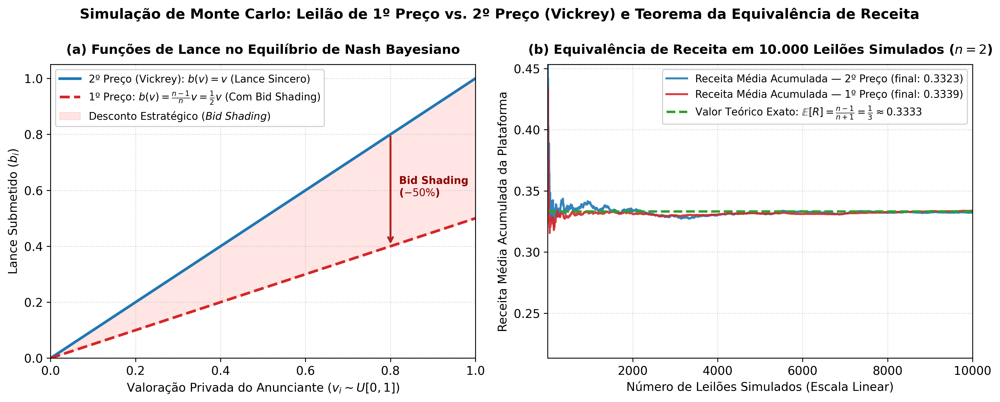

# Guia de Estudo e Planejamento — Grupo 5 (GED-62)
**Tema:** Leilões como Jogos Bayesianos: Lances, Maldição do Vencedor e Equivalência de Receita  
**Integrantes:** João Matheus Alves Lima, Lucas Ulrich Rafagnin, Mateus Fernandes Araujo, Pedro Ulisses de Lima Quadros *(Ponto Focal)*, Thiago Henrique Bueno  
**Datas importantes:** Entrega do Artigo até **16/11/2026** (`darcton.damiao@gp.ita.br`) | Apresentação em **25/11/2026** (20 min de exposição + 5 min de arguição).

---

## Sumário
1. [Visão Geral do Trabalho e Critérios do Professor](#1-visão-geral-do-trabalho-e-critérios-do-professor)
2. [Dicionário Lógico de Conceitos (Ordem Construtivo-Matemática)](#2-dicionário-lógico-de-conceitos-ordem-construtivo-matemática)
3. [Os Quatro Formatos Clássicos de Leilão e o Comportamento dos Lances](#3-os-quatro-formatos-clássicos-de-leilão-e-o-comportamento-dos-lances)
4. [Teorema da Equivalência de Receita: Intuição, Escopo e Quebras](#4-teorema-da-equivalência-de-receita-intuição-escopo-e-quebras)
5. [A Maldição do Vencedor (*Winner's Curse*)](#5-a-maldição-do-vencedor-winners-curse)
6. [O Modelo Resolvido Explicado Passo a Passo (Para o Artigo e Aula)](#6-o-modelo-resolvido-explicado-passo-a-passo-para-o-artigo-e-aula)
7. [Ligação com o Curso (O que o nosso tema acrescenta a GED-62)](#7-ligação-com-o-curso-o-que-o-nosso-tema-acrescenta-a-ged-62)
8. [Caso Real Escolhido: Leilões de Anúncios Online (Google Ads e *Ad Exchanges*)](#8-caso-real-escolhido-leilões-de-anúncios-online-google-ads-e-ad-exchanges)
9. [Referências Base do Repositório (Formato ABNT)](#9-referências-base-do-repositório-formato-abnt)

---

## 1. Visão Geral do Trabalho e Critérios do Professor

O objetivo deste documento é ensinar todo o conteúdo de **Teoria dos Leilões sob Jogos Bayesianos** ao grupo, de forma que qualquer integrante consiga explicar a matéria com segurança na aula de 20 minutos, responder à arguição de 5 minutos do Prof. Darcton e redigir as seções do artigo em formato ABNT (8 a 12 páginas).

### O que o professor vai avaliar no Artigo (5,0 pontos):
1. **Correção conceitual (2,0 pts):** Definições precisas e uso correto da notação (valores privados vs. valores comuns, leilões de 1º e 2º preço/Vickrey, equivalência de receita e maldição do vencedor).
2. **Modelo resolvido (2,0 pts):** Solução completa, passo a passo, com interpretação (leilão de 1º preço com 2 participantes e valores uniformes em $[0,1]$, derivação do lance de equilíbrio e comparação de receita com o leilão de 2º preço).
3. **Caso real (1,0 pt):** Descrição, modelagem como jogo (jogadores, estratégias, informação disponível e *payoffs*), uso de fontes e discussão crítica.

---

## 2. Dicionário Lógico de Conceitos (Ordem Construtivo-Matemática)

Para ensinar este tema como se fosse uma construção matemática — mas sem depender de formalismo pesado — precisamos **definir explicitamente cada termo antes de usá-lo no próximo**. Abaixo está a cadeia lógica exata que devemos seguir tanto no texto quanto na aula.

---

### Passo Conceitual 1: Da Informação Completa para o Jogo Bayesiano

> **Definição 1 — Jogo de Informação Completa:**  
> É um jogo em que todos os jogadores conhecem perfeitamente quem são os participantes, quais ações cada um pode tomar e **quanto cada jogador ganha (*payoff*) em qualquer combinação de ações**. Não há segredo sobre os objetivos, custos ou avaliações dos adversários.

**Exemplo para fixar:** Pense no *Dilema dos Prisioneiros* ou num jogo de Xadrez. No Dilema dos Prisioneiros, o Prisioneiro A sabe exatamente quantos anos de cadeia o Prisioneiro B pega em cada célula da matriz. Não existe nenhuma dúvida do tipo *"será que o meu comparsa gosta de ficar preso?"*. Tudo está aberto na mesa.

Porém, em um leilão real, a **Informação Completa não existe**: se você está disputando um carro usado, um imóvel ou uma concessão pública contra um concorrente, você sabe o quanto aquele bem vale para você, mas **não sabe o quanto ele vale na cabeça ou no bolso do seu adversário**. Isso nos leva à segunda definição:

> **Definição 2 — Jogo de Informação Incompleta (Jogo Bayesiano):**  
> É um jogo no qual pelo menos um jogador desconhece a função de *payoff* (o ganho líquido) de outro jogador, porque esse ganho depende de informações privadas que só o outro jogador conhece.

**O grande impasse histórico (antes de 1967):**  
Até a década de 1960, os economistas achavam que era impossível aplicar o Equilíbrio de Nash a jogos de informação incompleta. Por quê? Porque para eu saber qual é a minha melhor jogada, eu preciso prever a sua jogada. Mas a sua jogada depende do seu *payoff* secreto, que eu não sei! Então eu teria que chutar o que eu acho do seu *payoff*, e você teria que chutar *o que você acha que eu acho do seu payoff*, gerando uma **regressão infinita de crenças** impossível de calcular.

Como **William Vickrey (1961)** (nos leilões) e **John Harsanyi (1967–1968)** (para qualquer jogo, o que lhe rendeu o Prêmio Nobel de 1994 junto com Nash) resolveram esse impasse? Eles criaram um truque genial chamado **Transformação de Harsanyi**, baseado nos conceitos de **Tipo Privado** e ***Prior* Comum**:

> **Definição 3 — Tipo Privado ($\theta_i$):**  
> É o pedaço de informação secreta que pertence exclusivamente ao jogador $i$ e que determina o seu *payoff*. Nos leilões, o **tipo** de um comprador nada mais é do que a sua informação privada sobre o valor do objeto (o máximo que ele estaria disposto a pagar, ou a estimativa técnica que a equipe dele fez sobre o bem).

**Exemplo prático de Tipo:** Imagine que duas construtoras (Construtora 1 e Construtora 2) participam de uma licitação para construir uma ponte. A Construtora 1 tem máquinas novas e consegue fazer a obra por R\$ 80 milhões; a Construtora 2 tem máquinas antigas e gasta R\$ 95 milhões. Esse custo interno secreto de cada empresa é o **Tipo ($\theta_i$)** dela. Cada construtora olha a sua própria planilha e vê o seu próprio Tipo, mas não vê a planilha da concorrente.

Mas se a Construtora 1 não vê a planilha da Construtora 2, como ela consegue tomar uma decisão racional? É aqui que entra o conceito mais importante da modelagem bayesiana:

> **Definição 4 — Distribuição de Crenças a Priori (*Prior* Comum $F$):**  
> É a distribuição conjunta de probabilidade $F(\theta_1, \theta_2, \dots, \theta_n)$ segundo a qual a "Natureza" sorteia os **Tipos** de todos os jogadores antes de o jogo começar, sendo essa regra estatística de sorteio conhecida por todos os participantes.

---

#### 🔍 Explicação Detalhada: O que significa exatamente "*Prior* Comum ($F$)" e de onde surgiu esse termo?

Essa é uma das dúvidas mais importantes de toda a Teoria dos Jogos. Vamos desmontar o nome peça por peça e responder se essa distribuição é universal (igual para todos), particular a cada indivíduo ou intermediária:

1. **De onde surgiu a palavra "*Prior*" (A Priori)?**  
   Surgiu da **Estatística Bayesiana** (Teorema de Bayes). Em latim, *a priori* significa **"antes da experiência / antes de olhar os dados"**, em oposição a *a posteriori* (**"depois de olhar os dados"**).  
   Harsanyi propôs imaginar que todo Jogo de Informação Incompleta começa na verdade um passo antes, com um jogador fictício chamado **Natureza** (como um *croupier* de cassino):
   - No instante zero (**estágio *ex ante* / a priori**), a Natureza gira uma roleta probabilística $F$ e sorteia um "cartão secreto" com o Tipo $\theta_i$ para cada jogador $i$. A distribuição estatística dessa roleta inicial é o **Prior**!
   - No instante um (**estágio** *interim*), cada jogador espia apenas o seu próprio cartão $\theta_i$ (sem ver o dos outros) e atualiza suas probabilidades usando a Regra de Bayes.

2. **Por que se chama "*Comum*" (*Common Prior* / Doutrina de Harsanyi)?**  
   Cuidado com uma armadilha de linguagem aqui! **"Prior Comum" NÃO significa necessariamente que todos os jogadores são sorteados da mesma curva estatística!**  
   A palavra **"Comum"** vem de **Conhecimento Comum** (*Common Knowledge*): significa apenas que **todos os jogadores da mesa conhecem e concordam sobre quais são as regras da roleta da Natureza ($F$)**! Ou seja, não existe um jogador achando que o baralho tem 52 cartas e outro achando que o baralho tem 100 cartas. Todos conhecem a função $F(\theta_1, \dots, \theta_n)$ que governa o mundo.

3. **Então a distribuição de tipos é universal (igual para todos), particular a cada indivíduo ou intermediária?**  
   **Ela pode ser qualquer um dos três casos**, dependendo do leilão que você está modelando! A função conjunta $F(\theta_1, \dots, \theta_n)$ é a "lei geral do universo do jogo", mas dentro dela cada indivíduo pode ter a sua própria curva marginal $F_i(\theta_i)$ e a sua própria visão condicional após ver o próprio tipo. Veja os **três exemplos práticos** abaixo para nunca mais confundir:

   - **Caso A — Distribuição Universal / Jogadores Simétricos e Independentes ($F_1 = F_2 = \dots = F_n$):**  
     *Exemplo:* Dois estudantes do ITA (João e Lucas) vão disputar um ingresso extra para uma festa num leilão. Nenhum dos dois tem uma vantagem especial a priori: o quanto cada um valoriza o ingresso pode ser modelado como um sorteio uniforme entre R\$ 0 e R\$ 100 ($v_{\text{João}} \sim U[0,100]$ e $v_{\text{Lucas}} \sim U[0,100]$).  
     $\rightarrow$ Aqui, **a distribuição de onde os tipos saem é a mesma para todos os indivíduos** (chamamos de **jogadores simétricos**). É exatamente o caso do nosso **Modelo Resolvido** ($v_1, v_2 \sim U[0,1]$).

   - **Caso B — Distribuição Particular a Cada Indivíduo / Jogadores Assimétricos ($F_1 \neq F_2$), mas de Conhecimento Comum:**  
     *Exemplo:* No leilão do 5G da Anatel, a **Vivo** (Jogador 1, gigante nacional que já tem milhares de torres espalhadas pelo país) disputa uma faixa contra uma **pequena provedora do interior** (Jogador 2).  
     Todo mundo no mercado sabe que a Vivo tira muito mais proveito dessa faixa do que a pequena provedora. Logo, a "roleta da Natureza" sorteia o valor da Vivo num intervalo alto, digamos entre **R\$ 500 mi e R\$ 1.000 mi** ($F_{\text{Vivo}}$), enquanto sorteia o valor da pequena provedora num intervalo baixo, entre **R\$ 100 mi e R\$ 400 mi** ($F_{\text{Pequena}}$).  
     $\rightarrow$ Perceba: **cada jogador tem a SUA distribuição particular ($F_{\text{Vivo}} \neq F_{\text{Pequena}}$)!** Não é uma curva universal única para todas as empresas! **E por que ainda é um *Prior Comum*?** Porque tanto a Vivo quanto a Pequena *sabem* que o valor da Vivo sai da curva $[500, 1000]$ e que o valor da Pequena sai da curva $[100, 400]$! O "mapa estatístico" é público, embora cada indivíduo more numa região diferente do mapa.

   - **Caso C — O Caso Intermediário (Tipos Correlacionados: mesmo *Prior* inicial, mas *Posterior* diferente na cabeça de cada indivíduo!):**  
     *Exemplo:* Imagine um jogo de pôquer (ou um leilão de petróleo com Valor Comum). Antes de o *dealer* dar as cartas, o baralho de 52 cartas é o **Prior Comum** (qualquer jogador tem $\frac{4}{52}$ de chance de receber um Ás).  
     Mas agora cada jogador olha a própria mão (seu **Tipo** $\theta_i$):
     - O **Jogador 1** olha suas 2 cartas e vê que **tirou dois Ases**! Na cabeça do Jogador 1, qual passou a ser a distribuição de probabilidade das cartas do Jogador 2? Agora só restam **2 Ases** nas 50 cartas desconhecidas ($\frac{2}{50}$)!
     - Já o **Jogador 2** olha suas cartas e vê um **2 e um 7**. Na cabeça do Jogador 2, ainda existem **4 Ases** nas 50 cartas desconhecidas ($\frac{4}{50}$)!
     $\rightarrow$ Veja como isso responde exatamente à sua intuição de **"algo intermediário"**: antes de ver o seu Tipo, todos partem da mesma lei geral $F(\theta_1, \theta_2)$ (*Prior Comum*); mas **depois que cada indivíduo vê o seu próprio Tipo ($\theta_i$)**, cada um calcula a sua **distribuição condicional particular** $F(\theta_{-i} \mid \theta_i)$ (chamada de crença *a posteriori* ou *interim*), que é diferente de pessoa para pessoa!

---

#### 📌 Parêntese de Notação: O que significam os símbolos $\theta_{-i}$ e $b_{-i}$ (o subscrito $-i$)?

Em Teoria dos Jogos, sempre que aparece o índice $-i$ (lê-se *"menos i"* ou *"todos exceto i"*), ele é uma abreviação padrão para representar **o vetor de todos os outros jogadores da mesa, tirando o jogador** $i$:
- **Tipos de todos os outros exceto $i$ ($\theta_{-i}$):**  
  Se o jogo tem $n$ jogadores $\lbrace 1, 2, \dots, n\rbrace$, então:
  $$\theta_{-i} = (\theta_1, \dots, \theta_{i-1}, \theta_{i+1}, \dots, \theta_n)$$
  - *Exemplo com 2 jogadores (João = 1, Lucas = 2):* Se estamos olhando do ponto de vista do João ($i = 1$), quem é "todo mundo menos o João" ($-1$)? É só o Lucas ($2$)! Então $\theta_{-1} = \theta_2$.
  - *Exemplo com 3 jogadores (1, 2 e 3):* Para o Jogador 1 ($i=1$), $\theta_{-1} = (\theta_2, \theta_3)$, que é o par de tipos dos dois adversários dele.
  - Assim, escrever $F(\theta_{-i} \mid \theta_i)$ significa simplesmente: *"A distribuição de probabilidade que o jogador $i$ atribui aos **tipos dos seus adversários ($\theta_{-i}$)**, dado que ele já olhou o **seu próprio tipo ($\theta_i$)**"*.

- **Lances/Estratégias de todos os outros exceto $i$ ($b_{-i}$):**  
  Da mesma forma, $b_{-i}$ representa os lances (ou funções de lance) de todos os concorrentes do jogador $i$:
  $$b_{-i} = (b_1, \dots, b_{i-1}, b_{i+1}, \dots, b_n)$$
  - Por que essa notação é tão útil? Porque quando queremos escrever o *payoff* do jogador $i$ separando **aquilo que ele controla ($b_i$)** daquilo que **os adversários controlam ($b_{-i}$)**, em vez de escrever $u_i(b_1, b_2, \dots, b_n)$ escrevemos simplesmente $u_i(b_i, b_{-i})$!

---

Agora veja como o conceito de **Tipo**, de **Prior Comum** e da notação $-i$ transforma a definição de **Estratégia** e de **Equilíbrio**:

> **Definição 5 — Estratégia em um Jogo Bayesiano ($b_i(\theta_i)$):**  
> Em um jogo bayesiano, uma estratégia **não é uma única ação isolada**, mas sim um **plano completo (uma função matemática)** que especifica qual ação (lance) o jogador $i$ escolherá **para cada Tipo $\theta_i$ que a Natureza possa ter sorteado para ele**.

**Por que a estratégia precisa ser uma função e não um número só?**  
Imagine que você é o Jogador 1 e seu valor sorteado hoje foi $v_1 = 80$ (R\$ 80). Para você decidir quanto dar de lance hoje, você precisa pensar no que o Jogador 2 vai fazer. Mas você **não sabe** qual valor $v_2$ o Jogador 2 tirou hoje! O Jogador 2 pode ter tirado $v_2 = 10$ (R\$ 10), ou $v_2 = 50$ (R\$ 50), ou $v_2 = 90$ (R\$ 90).  
Portanto, você só consegue calcular a probabilidade de vencer o Jogador 2 se você souber a **regra (função)** $b_2(v_2)$ que o Jogador 2 usa para transformar *qualquer valor $v_2$ que ele tenha tirado* em um lance! Por exemplo: *"Eu não sei quanto o carro vale para o Lucas, mas sei que a regra estratégica do Lucas é dar de lance metade do valor dele ($b_2(v_2) = 0{,}5 \cdot v_2$)"*.

> **Definição 6 — Equilíbrio de Nash Bayesiano (ENB):**  
> É um perfil de funções de estratégia $\big(b_1^\ast(\theta_1), b_2^\ast(\theta_2), \dots, b_n^\ast(\theta_n)\big)$ — uma regra de lance para cada jogador — tal que, para todo jogador $i$ e para todo Tipo possível $\theta_i$ desse jogador, o lance $b_i^\ast(\theta_i)$ maximiza o **ganho médio esperado** de $i$ (calculado sobre a distribuição de tipos dos adversários $F(\theta_{-i} \mid \theta_i)$), dado que todos os outros jogadores estão usando as funções de lance $b_{-i}^\ast(\theta_{-i})$.

---

#### ⚠️ Dúvida Crucial: O ENB atinge o ganho máximo para *quaisquer combinações de tipos*?

**Cuidado! Essa é uma distinção fundamental entre o seu próprio tipo ($\theta_i$) e os tipos dos seus adversários ($\theta_{-i}$):**

1. **Em relação ao SEU PRÓPRIO tipo ($\theta_i$): SIM, para qualquer tipo seu!**  
   A sua função de equilíbrio $b_i^\ast(\theta_i)$ precisa ser a melhor resposta **para cada valor $\theta_i$ que VOCÊ possa ter tirado**. Se você tirou $v_1 = 20$ (R\$ 20), $b_1^\ast(20)$ tem que ser ótimo; se tirou $v_1 = 80$ (R\$ 80), $b_1^\ast(80)$ tem que ser ótimo. Por quê? Porque na hora de escrever o envelope, **você já sabe qual é o seu próprio tipo ($\theta_i$)**!

2. **Em relação à combinação com os tipos DOS OUTROS ($\theta_{-i}$): NÃO para cada combinação isolada (*ex post*), mas SIM NA MÉDIA ESPERADA (*interim*)!**  
   Por que o ENB **não** exige atingir o ganho máximo para cada combinação específica $(\theta_1, \theta_2)$ realizada? **Porque na hora de dar o lance você não tem bola de cristal para saber qual tipo $\theta_2$ o seu adversário tirou naquela rodada!**  


> **Resumo de Ouro (A diferença entre 1º Preço e 2º Preço):**
> - No **Leilão de 1º Preço**, o equilíbrio $b^\ast(v_i) = v_i/2$ é um **Equilíbrio de Nash Bayesiano padrão (ótimo em média)**: ele maximiza o seu ganho esperado tirando a média sobre todos os tipos possíveis do rival, embora *depois que o envelope abre* você quase sempre pense *"puxa, se eu soubesse o número dele eu teria dado um pouco menos ou um pouco mais"*.
> - Já no **Leilão de 2º Preço (Vickrey)** com valores privados, acontece um milagre raro: a estratégia sincera $b^\ast(v_i) = v_i$ atinge o ganho máximo **para QUALQUER combinação específica de tipos** $(v_1, v_2)$, mesmo depois que os envelopes são abertos! (Quando isso acontece, dizemos que além de ser um ENB, é um **Equilíbrio em Estratégias Dominantes** (*Equilíbrio Ex Post*), onde ninguém nunca se arrepende depois de abrir os envelopes!).

---

#### 🧠 Mas no ENB estamos assumindo que todos os jogadores conhecem as funções de estratégia uns dos outros?

**SIM! Exatamente!** Mas aqui mora a diferença mais elegante da teoria dos jogos bayesianos: **você conhece a FUNÇÃO (a fórmula) do seu adversário, mas NÃO conhece o RESULTADO NUMÉRICO (o lance final) dela!**

Use a **Analogia da Calculadora de Vidro** para entender isso perfeitamente:
- Imagine que cada jogador tem na sua frente uma calculadora programada com uma fórmula matemática: a função de estratégia $b_j^\ast(v_j)$ (por exemplo, $b_2^\ast(v_2) = \frac{v_2}{2}$).
- No Equilíbrio de Nash Bayesiano, **essa calculadora é de vidro transparente**: o Jogador 1 sabe perfeitamente que a fórmula programada na calculadora do Jogador 2 é *"dividir por 2"*, e o Jogador 2 sabe que a fórmula da calculadora do Jogador 1 também é *"dividir por 2"*.
- **Então onde está o segredo do jogo?** O segredo está apenas **no número $v_2$ (o Tipo secreto) que o Jogador 2 digitou na calculadora dele hoje**!
- Como você conhece:
  1. a distribuição de probabilidade dos números que ele pode digitar ($v_2 \sim U[0, 100]$), e
  2. a fórmula da calculadora dele ($b_2^\ast(v_2) = v_2 / 2$),  
  você deduz imediatamente a distribuição de probabilidade dos lances que vão sair da calculadora dele: os lances do Jogador 2 são uma variável aleatória uniforme entre R\$ 0 e R\$ 50 ($b_2 \sim U[0, 50]$)!

**Mas como um jogador descobre a função do outro na vida real se eles não combinaram antes?**  
Pela mesma hipótese do Equilíbrio de Nash clássico (dedução racional mútua ou aprendizado de mercado): você se coloca no lugar do seu concorrente, sabe que ele é racional e enfrenta a mesma equação de otimização que você, e ambos deduzem qual é o único par de funções $(b_1^\ast, b_2^\ast)$ no qual ninguém tem incentivo para mudar de fórmula.

> **E se eu NÃO confiar que meu adversário sabe calcular o equilíbrio?**  
> É aí que entra mais uma vantagem histórica apontada por **Vickrey (1961, p. 20)** para o **Leilão de Segundo Preço**:
> - No **Leilão de 1º Preço**, a sua melhor resposta ($b_1^\ast(v_1) = v_1/2$) **depende** de o seu adversário estar usando a função certa ($b_2^\ast(v_2) = v_2/2$). Se o seu adversário for irracional e usar outra função (por exemplo, $b_2(v_2) = 0{,}9 v_2$), a sua melhor função também muda!
> - Já no **Leilão de 2º Preço (Vickrey)** com valores privados, como $b_1^\ast(v_1) = v_1$ é uma **estratégia dominante**, **você NÃO precisa saber qual é a função de estratégia dos seus concorrentes!** Mesmo que os seus rivais usem fórmulas malucas, aleatórias ou irracionais, a sua melhor função continua sendo $b_1^\ast(v_1) = v_1$!

---

### Passo Conceitual 2: Os Elementos de um Leilão

Agora que sabemos o que é um **Jogo Bayesiano**, um **Tipo**, um **Prior Comum** e uma **Estratégia**, podemos definir formalmente os elementos específicos de um **Leilão**:

> **Definição 7 — Valoração ($v_i$) e Excedente (*Payoff* $u_i$):**  
> A **Valoração ($v_i$)** é o valor monetário máximo que o objeto leiloado tem para o jogador $i$ (a sua disposição máxima a pagar).  
> Se o jogador $i$ vence o leilão e paga um preço $p$, o seu ganho líquido (chamado de **Excedente do Comprador** ou **Payoff**) é:
> $$u_i = v_i - p$$
> Se o jogador $i$ perde o leilão e não paga nada, o seu *payoff* é $u_i = 0$.

**Exemplo numérico simples:** Se um relógio raro vale para você $v_i = 1.000$ (R\$ 1.000) (porque é o máximo que você pagaria sem ficar triste nem feliz) e você vence o leilão pagando $p = 650$ (R\$ 650), você sai da sala com um ganho líquido de utilidade (*payoff*) de $1.000 - 650 = 350$ (R\$ 350). Se você pagasse $p = 1.100$ (R\$ 1.100), teria um *payoff* negativo de $-100$ (prejuízo de R\$ 100).

Como essa **Valoração ($v_i$)** se relaciona com o **Tipo ($\theta_i$)** de cada jogador? Existem dois ambientes clássicos na teoria dos leilões (KLEMPERER, 2004, p. 13–14):

> **Definição 8 — Modelo de Valores Privados Independentes (IPV — *Independent Private Values*):**  
> É o ambiente de leilão em que:
> 1. **Valor Privado ($v_i = \theta_i$):** Cada jogador $i$ conhece com 100% de certeza qual é a sua própria **Valoração** $v_i$ antes do leilão começar. Mesmo que ele espionasse e descobrisse o **Tipo** dos concorrentes, isso **não mudaria em um centavo** o quanto o objeto vale para ele.
> 2. **Independência Estatística:** O valor $v_i$ de um jogador foi sorteado de forma independente do valor $v_j$ dos outros jogadores (saber que $v_1$ é alto não altera a distribuição de probabilidade de $v_2$).

**Exemplo do Mundo Real (Valor Privado):**  
Imagine o leilão de uma camisa autografada do seu time de coração (para você emoldurar na parede e nunca revender), ou o leilão de um jantar beneficente com um artista. Você sabe exatamente quanta satisfação pessoal aquilo te dá (digamos, R\$ 500). Se você descobrir que o seu vizinho daria apenas R\$ 20 pela camisa porque ele torce para outro time, a camisa passa a valer menos para você? **Não!** Ela continua valendo R\$ 500 para você. (Saber que o vizinho só dá R\$ 20 ajuda você a *dar um lance menor para economizar*, mas não muda o *valor intrínseco* do bem para você).

No artigo seminal de 1961, Vickrey descreve exatamente essa hipótese:

> **Trecho de referência (VICKREY, 1961, p. 14):**  
> *"Wait now for the case of a single indivisible object... It is assumed that each bidder has a 'value' for the object in question, clear of all transaction costs, and that the object is worth nothing to the seller... We assume first that the values of the respective bidders can be represented as independent random variables drawn from a common probability distribution."*  
> *(Tradução livre: Consideremos o caso de um único objeto indivisível... Assume-se que cada licitante tem um 'valor' para o objeto em questão... Assumimos primeiramente que os valores dos respectivos licitantes podem ser representados como variáveis aleatórias independentes extraídas de uma distribuição de probabilidade comum.)*

Agora compare isso com o polo oposto, onde ninguém sabe o verdadeiro valor do bem:

> **Definição 9 — Modelo de Valor Comum Puro (CV — *Common Value*):**  
> É o ambiente de leilão em que o objeto tem **exatamente o mesmo valor final objetivo $V$ para todos os participantes** ($v_1 = v_2 = \dots = v_n = V$), mas **ninguém conhece o valor verdadeiro $V$ no momento do leilão**. O **Tipo** de cada jogador ($\theta_i = s_i$) é apenas um **Sinal Privado** (uma medição ou estimativa com margem de erro, $s_i = V + \varepsilon_i$) sobre o verdadeiro valor $V$. Nesse ambiente, se um jogador descobrisse o **Sinal Privado** dos outros jogadores, ele **mudaria imediatamente a sua própria estimativa** de quanto o objeto vale!

**Exemplo do Mundo Real (Valor Comum):**  
Imagine que a Agência Nacional do Petróleo (ANP) está leiloando os direitos de exploração de um bloco marítimo no pré-sal. A quantidade física de petróleo que existe lá embaixo (e o preço internacional do barril daqui a 5 anos) é **uma só ($V$)**, seja a Petrobras, a Shell ou a Chevron a vencedora. Porém, antes de perfurar, ninguém sabe o valor exato de $V$.  
Cada empresa manda seus próprios navios sísmicos e geólogos fazerem um estudo secreto:
- O geólogo da Empresa 1 estima que há US\$ 1,2 bilhão em petróleo ($s_1 = 1{,}2$ bi);
- O geólogo da Empresa 2 estima que há US\$ 0,8 bilhão ($s_2 = 0{,}8$ bi);
- O geólogo da Empresa 3 estima que há US\$ 0,7 bilhão ($s_3 = 0{,}7$ bi).  
Note a diferença brutal para o caso da camisa autografada: se o presidente da Empresa 1 vazasse uma informação e descobrisse que os geólogos da Shell e da Chevron acharam apenas 0,8 bi e 0,7 bi, o presidente da Empresa 1 diria na hora: *"Opa! O meu geólogo provavelmente foi otimista demais, esse poço deve valer perto de 0,9 bi e não 1,2 bi!"*. Ou seja, a informação do adversário **altera o valor esperado do objeto**!

Paul Klemperer explica essa distinção logo nas primeiras páginas do livro da nossa pasta:

> **Trecho de referência (KLEMPERER, 2004, p. 13–14):**  
> *"In the basic private-value model each bidder knows how much she values the object(s) for sale, spacing out any uncertainty about the value to her if she wins; however, each bidder's value is private information to herself. By contrast, in the pure common-value model the actual value is the same for everyone, but bidders have different private information about what that value actually is. For example, the value of an oil lease depends on how much oil is under the ground, and bidders may have access to different geological "signals" about that amount. In this case a bidder would change her estimate of the value if she learned another bidder's signal, in contrast to the private-value case in which her value would be unaffected by learning execution of any other bidder's preferences or information."*

> **E os casos mistos da vida real?**  
> Klemperer (2004, p. 14) destaca que a maioria dos leilões reais é um meio-termo entre os dois extremos (chamado de **Modelo de Valores Interdependentes ou Quase-Comuns**): por exemplo, no leilão do 5G ou na compra de uma empresa, cada licitante tem **elementos privados** (sua própria rede de torres e eficiência administrativa) e **elementos comuns** (o crescimento do PIB brasileiro e a adesão dos consumidores à tecnologia 5G).

---

## 3. Os Quatro Formatos Clássicos de Leilão e o Comportamento dos Lances

Usando os conceitos de **Tipo**, **Valoração** e **Estratégia**, a literatura define quatro formatos padrão para leiloar um único item (VICKREY, 1961; KLEMPERER, 2004, p. 11–12):

| Formato de Leilão | Como Funciona (Regra de Alocação e Pagamento) |
| :--- | :--- |
| **1. Ascendente Aberto (Inglês)** | O preço começa baixo e vai subindo. Os participantes vão saindo até sobrar apenas um, que vence e paga o preço em que o penúltimo desistiu. |
| **2. Descendente Aberto (Holandês)** | O preço começa muito alto em um relógio e vai caindo. O primeiro participante que gritar *"Pare!"* vence imediatamente e paga o preço mostrado no relógio naquele instante. |
| **3. Primeiro Preço em Envelope Fechado** | Cada participante entrega um lance secreto $b_i$ num envelope. Quem deu o maior lance vence e **paga o valor do seu próprio lance ($b_i$)**. |
| **4. Segundo Preço em Envelope Fechado (Vickrey)** | Cada participante entrega um lance secreto $b_i$ num envelope. Quem deu o maior lance vence, mas **paga o valor do segundo maior lance** entregue pelos concorrentes. |

---

#### 🙋‍♂️ Explicação Detalhada: Como funciona exatamente a dinâmica do Leilão Inglês? (Quem propõe os valores e como funciona "levantar/abaixar a mão"?)

Na prática e na teoria, o **Leilão Inglês (Ascendente)** pode ser conduzido de **três formas equivalentes** (KLEMPERER, 2004, p. 11–12; VICKREY, 1961, p. 13–14). Entender as três tira qualquer dúvida na hora da apresentação:

1. **Modalidade 1 — Os próprios participantes gritam os valores (*Open-Outcry* / Viva-Voz de Salão):**  
   É o leilão clássico de filmes (como na *Sotheby's* ou leilões de gado). O leiloeiro abre o lote e **os próprios participantes levantam a mão/plaqueta e propõem valores maiores** que o lance anterior (*"Dou R\$ 100!"*, *"Dou R\$ 120!"*), ou o leiloeiro vai sugerindo o próximo degrau mínimo (*"Tenho R\$ 120, alguém dá R\$ 125?"*) e o participante apenas levanta a mão para aceitar aquele degrau. O leilão termina quando mais ninguém levanta a mão para cobrir o último lance (*"Dou-lhe uma, dou-lhe duas, vendido!"*).

2. **Modalidade 2 — O Leiloeiro sobe o preço continuamente num Relógio e todos começam com a mão levantada (*Ascending Clock* / "Leilão Japonês de Botão"):**  
   Quando os matemáticos e economistas (como Vickrey e Klemperer) vão modelar o Leilão Inglês, se cada participante puder gritar qualquer número (por exemplo, pular de R\$ 100 direto para R\$ 500 para tentar intimidar a sala), o jogo fica cheio de detalhes de qual é o "degrau mínimo". Para deixar a dinâmica limpa e contínua, a Teoria dos Jogos modela o Leilão Inglês assim:
   - Imagine um **relógio digital no telão** que começa em **R\$ 0,00** e vai subindo de centavo em centavo sem parar (R\$ 1, R\$ 2, R\$ 3...).
   - **No preço R\$ 0,00, TODOS os interessados começam em pé (ou com a mão levantada / segurando um botão apertado)**, o que significa: *"Neste preço atual do telão, eu estou dentro!"*.
   - Conforme o preço no telão vai subindo e ficando caro, quem acha que o preço chegou no seu limite **abaixa a mão (ou senta / solta o botão)** e está eliminado da rodada (não pode voltar atrás).
   - No exato instante em que o **penúltimo** participante abaixa a mão, só resta **um único participante com a mão levantada**! Nesse milissegundo o relógio trava, e esse último participante leva o objeto pagando **exatamente o preço que estava no telão quando o penúltimo abaixou a mão**!

3. **Por que a Modalidade 1 (participantes propondo lances) e a Modalidade 2 (abaixar a mão no relógio) dão exatamente o mesmo resultado?**  
   Veja um **exemplo numérico passo a passo** com 3 participantes:
   - Suponha que o quadro vale $v_{\text{Ana}} = 50$ (R\$ 50) para a Ana, $v_{\text{Lucas}} = 80$ (R\$ 80) para o Lucas e $v_{\text{João}} = 100$ (R\$ 100) para o João.
   - **No modelo do Relógio (abaixar a mão):**
     - O telão começa em R\$ 0 com os três de mão levantada.
     - Quando o telão bate **R\$ 50**, a Ana pensa: *"Passou de R\$ 50 eu tenho prejuízo"*, e **abaixa a mão**. Continuam Lucas e João.
     - O telão continua subindo: R\$ 60... R\$ 70... Quando bate **R\$ 80**, o Lucas pensa: *"Para mim só vale R\$ 80"*, e **abaixa a mão**.
     - Nesse exato instante em R\$ 80, só sobrou o João de mão levantada! O relógio para em **R\$ 80**. O João (que pagaria até R\$ 100!) vence e paga apenas **R\$ 80** (o valor do segundo colocado, Lucas!).
   - **No modelo tradicional (participantes propondo lances de R\$ 1 em R\$ 1):**
     - Ana, Lucas e João vão dando lances: R\$ 48, R\$ 49, R\$ 50... Em R\$ 50 a Ana para de levantar a plaqueta.
     - Agora ficam só Lucas e João rebatenando um ao outro: Lucas dá R\$ 78 $\to$ João dá R\$ 79 $\to$ Lucas dá **R\$ 80** (o limite máximo do Lucas).
     - O João (que aguenta ir até R\$ 100) cobre com **R\$ 80,01** (ou R\$ 81, um degrau mínimo acima de 80).
     - O leiloeiro olha para o Lucas: *"Alguém cobre R\$ 80,01?"*. Como para o Lucas só vale R\$ 80, o Lucas não levanta mais a mão!
     - **Resultado:** O João vence pagando **R\$ 80,01 $\approx$ R\$ 80**! Perceba que o João **nunca precisou abrir a boca para dizer que o limite dele era R\$ 100**; ele só precisou superar o limite do segundo colocado (R\$ 80) por um tiquinho!

> **Trecho de referência (KLEMPERER, 2004, p. 11):**  
> *"In the ascending auction (also called the English or oral or open-outcry auction), the price is successively raised until only one bidder remains, and that bidder wins the object at the final price. This auction can be run by having the seller announce prices, or by having the bidders call out prices themselves, or electronically with the best current bid posted; for most purposes these versions are equivalent."*

---

### 3.1. Duas Equivalências Estratégicas Fundamentais

Antes mesmo de fazer contas, Vickrey (1961) e Klemperer (2004, p. 11–12) mostram duas conexões diretas entre os formatos abertos e fechados:

1. **Leilão Holandês $\equiv$ Leilão de Primeiro Preço em Envelope Fechado (Sempre equivalentes!):**  
   Por quê? No leilão holandês, ninguém vê ninguém fazer nada até o momento em que alguém aperta o botão e o jogo acaba na hora. Portanto, a única decisão estratégica que você toma antes de o relógio começar a cair é: *"Em qual número exato eu vou apertar o botão se ninguém apertar antes de mim?"*. Escolher esse número de parada e pagar exatamente ele caso você seja o mais alto é **100% idêntico** a escrever esse número dentro de um envelope fechado no leilão de primeiro preço!
   > **Trecho de referência (VICKREY, 1961, p. 20):**  
   > *"It is fairly clear on rational grounds that the Dutch auction and the first-price sealed-bid procedure are isomorphic, in the sense that a rational player who decides in advance at what price he will claim the lot in a Dutch auction is facing the exact same decision problem as one who writes down a bid in a first-price sealed tender."*

2. **Leilão Inglês $\equiv$ Leilão de Segundo Preço / Vickrey (Equivalentes sob Valores Privados!):**  
   Por quê? Como acabamos de ver no exemplo de Ana ($50$), Lucas ($80$) e João ($100$), no leilão inglês com **Valores Privados**, a estratégia ótima de cada participante é continuar no páreo exatamente até o preço atingir a sua **Valoração ($v_i$)** e desistir nesse ponto. Quando o penúltimo participante (Lucas) desiste no valor dele ($v_{(2)} = 80$), o participante de maior valor (João, $v_{(1)} = 100$) vence e paga exatamente o valor em que o segundo colocado desistiu ($80$) — que é exatamente a regra do leilão de **Segundo Preço de Vickrey** em envelope fechado!

---

### 3.2. Como se joga cada formato? (*Bid Shading* vs. Revelação Sincera)

Agora definimos os dois comportamentos estratégicos centrais que o professor cobrará:

> **Definição 10 — Sombreamento de Lance (*Bid Shading*):**  
> É o ato deliberado de submeter um lance **estritamente menor do que a sua verdadeira Valoração** ($b_i < v_i$).

Por que o **Sombreamento de Lance** é obrigatório no **Leilão de Primeiro Preço**? Olhe para a **fórmula do Valor Esperado do Ganho (*Payoff* Esperado)** do jogador $i$:
$$\mathbb{E}[u_i(b_i) \mid v_i] = \underbrace{(v_i - b_i)}\limits_{\text{Lucro se vencer}} \times \underbrace{\mathbb{P}\big(b_i > \max_{j \neq i} b_j\big)}\limits_{\text{Probabilidade de vencer}} + \underbrace{0 \times \mathbb{P}\big(b_i < \max_{j \neq i} b_j\big)}\limits_{\text{Ganho se perder } (=0)}$$
Veja o que essa fórmula de Valor Esperado revela imediatamente:
- Se você escrever o seu valor verdadeiro no envelope ($b_i = v_i$), o primeiro termo $(v_i - b_i)$ zera:
  $$\mathbb{E}[u_i(v_i) \mid v_i] = (v_i - v_i) \times \mathbb{P}(\text{vencer}) = 0$$
  Ou seja: **dar um lance igual ao seu valor verdadeiro no leilão de primeiro preço garante ganho esperado ZERO!**
- Para ter ganho esperado positivo, todo jogador racional precisa fazer **Sombreamento de Lance** ($b_i < v_i$), equilibrando o *trade-off* entre os dois fatores do produto:
  - **Subir o lance ($b_i \uparrow$):** Aumenta a probabilidade de vencer $\mathbb{P}(b_i > \max_{j \neq i} b_j) \uparrow$, mas diminui o lucro caso vença $(v_i - b_i) \downarrow$.
  - **Baixar o lance ($b_i \downarrow$):** Aumenta o lucro caso vença $(v_i - b_i) \uparrow$, mas diminui a probabilidade de vencer $\mathbb{P}(b_i > \max_{j \neq i} b_j) \downarrow$.
- Quando maximizamos esse Valor Esperado no Equilíbrio de Nash Bayesiano, descobre-se que o lance sombreado ótimo $b^\ast(v_i)$ é dado exatamente pelo **Valor Esperado do maior adversário, condicionado a todos os adversários terem valor menor que** $v_i$:
  $$b_{\text{1º Preço}}^\ast(v_i) = \mathbb{E}\Big[\,\max_{j \neq i} v_j \;\Big|\; \max_{j \neq i} v_j < v_i\,\Big]$$
  *(Para 2 jogadores com valores uniformes em $[0,1]$, a média de um adversário uniforme entre $0$ e $v_i$ é exatamente a metade: $b^\ast(v_i) = \mathbb{E}[v_2 \mid v_2 < v_1] = \frac{v_i}{2}$!).*

---

> **Definição 11 — Revelação Sincera de Valor (*Truthful Bidding*):**  
> É a estratégia na qual o jogador submete um lance **exatamente igual à sua verdadeira Valoração** ($b_i = v_i$).

---

#### 💡 Explicação Passo a Passo: Por que no Leilão de Segundo Preço (Vickrey) a melhor jogada é SEMPRE falar a verdade ($b_i = v_i$)?

A dúvida mais comum de quem vê o Leilão de Vickrey pela primeira vez é:
> *"Espera aí! Se um relógio vale **R\$ 100** para mim, por que eu vou escrever **R\$ 100** no envelope?! Se eu ganhar dando R\$ 100, eu não vou ter lucro zero igual no 1º Preço?! Não seria melhor eu escrever R\$ 70 para pagar mais barato?!"*

**A resposta é NÃO — e entender o porquê muda a sua visão sobre leilões!**

Lembre-se da regra do **Leilão de Segundo Preço (Vickrey)**:
- Se você ganhar o leilão, **você NUNCA paga o número que VOCÊ escreveu no seu envelope!**
- Você paga **o número que o SEU ADVERSÁRIO (o 2º colocado) escreveu no envelope dele!**

Vamos colocar números nisso. Suponha que estamos só você e um adversário disputando o relógio:
- Para **você**, o relógio vale $v_1 = 100$ (R\$ 100).
- O seu **adversário** escreveu um valor $M$ qualquer no envelope dele (que você não sabe qual é).

Primeiro, responda a esta pergunta simples: **Abaixo de qual preço vale a pena você levar esse relógio para casa, e acima de qual preço é furada (prejuízo)?**
- Se o preço a pagar (que é o lance $M$ do adversário!) for **menor que R\$ 100** (ex.: $M = 60$ ou $M = 85$), **você QUER ganhar**, porque vai pagar menos de R\$ 100 por algo que vale R\$ 100 para você!
- Se o preço a pagar (o lance $M$ do adversário) for **maior que R\$ 100** (ex.: $M = 110$ ou $M = 150$), **você QUER PERDER**, porque se ganhar terá que pagar mais de R\$ 100 por algo que só vale R\$ 100 para você!

Agora veja o que acontece quando você escreve **exatamente a verdade ($b_1 = 100$)** no seu envelope:
- O seu lance de **R\$ 100** funciona como um **"filtro automático perfeito"**:
  - Sempre que o lance do adversário $M$ for **menor que R\$ 100** (quando dá lucro!), o seu envelope de R\$ 100 **ganha** dele, e você paga só $M$!
  - Sempre que o lance do adversário $M$ for **maior que R\$ 100** (quando daria prejuízo!), o seu envelope de R\$ 100 **perde** para ele, salvando você de pagar caro demais!

---

#### 📊 Teste dos Céticos: "Mas o que acontece se eu tentar ser esperto e mentir no envelope?"

Vamos testar na tabela abaixo! O relógio vale $v_1 = 100$ (R\$ 100) para você. Compare o que acontece em três estratégias diferentes suas:
1. **Falar a verdade:** escrever $b_1 = 100$ (R\$ 100);
2. **Tentar dar uma de esperto e baixar o lance:** escrever $b_1 = 70$ (R\$ 70) (achando que vai economizar);
3. **Tentar ser agressivo e inflar o lance:** escrever $b_1 = 120$ (R\$ 120) (para intimidar e ganhar mais vezes).

Olhe na tabela o que acontece com o **seu lucro líquido** para cada possível lance $M$ que esteja dentro do envelope do seu adversário:

| Quanto estava no envelope do Adversário ($M$)? | Se você falar a VERDADE ($b_1 = 100$) | Se você MENTIR PARA BAIXO ($b_1 = 70$) | Se você MENTIR PARA CIMA ($b_1 = 120$) |
| :--- | :--- | :--- | :--- |
| **Caso 1: Adversário deu pouco ($M = 50$)** | Você ganha ($100 > 50$), paga o lance dele (**R\$ 50**) e lucra **+R\$ 50**. | Você ganha ($70 > 50$), paga o lance dele (**R\$ 50**) e lucra **+R\$ 50**. *(Baixar para 70 não economizou 1 centavo!)* | Você ganha ($120 > 50$), paga o lance dele (**R\$ 50**) e lucra **+R\$ 50**. *(Não mudou nada).* |
| **Caso 2: Adversário deu médio ($M = 85$)** | ✅ **Você ganha** ($100 > 85$), paga o lance dele (**R\$ 85**) e **lucra +R\$ 15**! | ❌ **VOCÊ PERDE** ($70 < 85$) e fica com **R\$ 0**! *(Por tentar baixar o lance para 70, você jogou fora R\$ 15 de lucro!)* | ✅ Você ganha ($120 > 85$), paga **R\$ 85** e lucra **+R\$ 15**. *(Igual a falar a verdade).* |
| **Caso 3: Adversário deu alto ($M = 110$)** | ✅ **Você perde** ($100 < 110$) e fica com **R\$ 0** *(escapou de pagar 110 por algo que vale 100!)*. | ✅ Você perde ($70 < 110$) e fica com **R\$ 0**. *(Igual a falar a verdade).* | ❌ **VOCÊ GANHA** ($120 > 110$), é **obrigado a pagar R\$ 110** por algo que só vale 100 e toma **PREJUÍZO de -R\$ 10**! |
| **Caso 4: Adversário deu muito alto ($M = 130$)** | Você perde ($100 < 130$) e fica com **R\$ 0**. | Você perde ($70 < 130$) e fica com **R\$ 0**. | Você perde ($120 < 130$) e fica com **R\$ 0**. |

Olhe para as duas últimas colunas da tabela e tire a prova real. Por isso, a conclusão de Vickrey (1961) foi: Não existe nenhum cenário em que mentir (para baixo ou para cima) dê mais dinheiro do que falar a verdade ($b_i = v_i$), e existem cenários em que mentir dá prejuízo! Por isso, $b_i = v_i$ é uma **Estratégia Fracamente Dominante** (e qualquer estratégia mentirosa $b_i \neq v_i$ é uma **Estratégia Fracamente Dominada**, isto é, uma estratégia para a qual existe outra — falar a verdade — que gera um *payoff* sempre maior ou igual para qualquer jogada dos adversários, e estritamente maior em pelo menos um cenário)!

> **Trecho de referência (VICKREY, 1961, p. 20):**  
> *"It is easily shown that the optimal strategy for each bidder in such a [second-price] procedure is to bid his full value $v_i$, regardless of what distribution of bids he expects from his competitors. [...] Each bidder can confine his efforts and attention to an appraisal of the value the article would have in his own hands, at a considerable saving in mental strain and possibly in out-of-pocket expense for conducting counter-speculation."*

---

## 4. Teorema da Equivalência de Receita: Enunciado, Intuição e Quebras

Uma pergunta natural surge quando comparamos o Leilão de 1º Preço e o Leilão de 2º Preço (Vickrey):
- No **1º Preço**, os jogadores escondem o jogo e dão lances menores que o valor verdadeiro ($b_i < v_i$), mas o vendedor recebe o **maior lance** da sala.
- No **2º Preço (Vickrey)**, os jogadores dão lances altos sinceros ($b_i = v_i$), mas o vendedor só recebe o **segundo maior lance** da sala.
- **Qual dos dois dá mais dinheiro para o vendedor?**

O resultado mais famoso da Teoria dos Leilões — descoberto por Vickrey (1961) para casos específicos e provado em sua forma geral por Myerson (1981) e Riley & Samuelson (1981) — é um **Teorema** (e não uma definição!) que separa claramente as **Hipóteses** da **Consequência**:

> **Teorema 1 — Teorema da Equivalência de Receita (RET — *Revenue Equivalence Theorem*):**
>
> **Hipóteses (Condições para o teorema valer):**  
> Considere a venda de um único objeto indivisível entre $n$ jogadores, assumindo que:
> 1. *(Hipótese de Informação — Valores Privados Independentes):* A valoração $v_i$ de cada jogador $i$ é informação privada dele e é estatisticamente independente das valorações dos demais jogadores;
> 2. *(Hipótese de Simetria):* As valorações $v_1, \dots, v_n$ de todos os jogadores são sorteadas de uma **mesma distribuição de probabilidade contínua** $F(v)$ definida num intervalo $[\underline{v}, \overline{v}]$ (sem "saltos" ou buracos);
> 3. *(Hipótese de Preferência — Neutralidade ao Risco):* Todos os jogadores são neutros ao risco (buscam maximizar apenas o valor esperado monetário do seu ganho líquido $\mathbb{E}[v_i - p]$);
> 4. *(Hipótese sobre os Formatos de Leilão Comparados):* Estamos comparando quaisquer dois mecanismos de leilão tais que, no Equilíbrio de Nash Bayesiano de cada um:
>    - **(4a) Alocação Eficiente:** O objeto acaba sempre nas mãos do jogador que tem a maior valoração $v_i$ entre todos os participantes; e
>    - **(4b) Condição de Contorno na Fronteira Inferior:** Um jogador que tire a menor valoração possível ($v_i = \underline{v}$, por exemplo $v_i = 0$) tem ganho líquido esperado igual a zero.
>
> **Consequência (Tese do Teorema):**  
> Se as hipóteses (1) a (4) forem satisfeitas, então:
> - **(i) Mesma Receita Esperada:** Todos esses formatos de leilão proporcionam **exatamente a mesma receita média esperada para o vendedor**; e
> - **(ii) Mesmo Pagamento Esperado por Tipo:** Qualquer jogador com valoração $v_i$ faz **exatamente o mesmo pagamento esperado** em todos esses formatos de leilão.  
> *(Em particular, os quatro formatos clássicos — Inglês, Holandês, 1º Preço e 2º Preço/Vickrey — geram exatamente a mesma receita esperada!).*

> **Trecho de referência (KLEMPERER, 2004, p. 17):**  
> *"For a flagship result, we have the Revenue Equivalence Theorem: Assume each of a given number of risk-neutral potential buyers of an object has a privately-known signal independently drawn from a common, strictly-increasing, atomless distribution. Then any auction mechanism in which (i) the object always goes to the buyer with the highest signal, and (ii) any bidder with the lowest-feasible signal expects zero surplus, yields the same expected revenue (and results in each bidder-type making the same expected payment as a function of her signal)."*

---

### 🧠 Qual é a intuição econômica por trás desse Teorema?

Para entender por que a receita do **1º Preço** empata exatamente com a do **2º Preço**, primeiro precisamos lembrar o que é o ***Bid Shading* (Sombreamento de Lance)** e por que ele acontece:

1. **O que é *Bid Shading* e por que ele acontece no 1º Preço (pela Fórmula do Valor Esperado)?**  
   *Bid shading* é o desconto estratégico que o comprador aplica sobre o seu próprio valor na hora de dar o lance ($b_i < v_i$).  
   Ele acontece porque, no **Leilão de 1º Preço**, quem vence paga o próprio lance, de modo que o **Valor Esperado do Ganho** do jogador $i$ é o produto:
   $$\mathbb{E}[u_i(b_i) \mid v_i] = \underbrace{(v_i - b_i)}\limits_{\text{Margem se vencer}} \times \underbrace{\mathbb{P}\big(b_i > \max_{j \neq i} b_j\big)}\limits_{\text{Probabilidade de vencer}}$$
   Se o jogador ofertar seu valor cheio ($b_i = v_i$), sua margem $(v_i - b_i)$ zera e seu ganho esperado é $0$. Ao maximizar $\mathbb{E}[u_i(b_i) \mid v_i]$, o lance ótimo de equilíbrio no 1º Preço resulta exatamente no **Valor Esperado do maior valor adversário, dado que ele é menor que** $v_i$:
   $$b_{\text{1º Preço}}^\ast(v_i) = \mathbb{E}\Big[\,\max_{j \neq i} v_j \;\Big|\; \max_{j \neq i} v_j < v_i\,\Big]$$
   Com 2 jogadores e valores uniformes (onde o adversário menor que $v_i$ está distribuído uniformemente entre $0$ e $v_i$), esse valor esperado é exatamente a **metade de** $v_i$:
   $$b_{\text{1º Preço}}^\ast(v_i) = \mathbb{E}[v_2 \mid v_2 < v_i] = \frac{v_i}{2} \quad (\text{desconto de } 50\%)$$
   Já no **2º Preço (Vickrey)**, como o vencedor paga o lance do adversário e não o seu, ninguém faz *bid shading*: todos dão **100%** do próprio valor ($b_{\text{2º Preço}}^\ast(v_i) = v_i$).

2. **Por que então as duas receitas dão exatamente o mesmo valor na média?**  
   Olhe o **"cabo de guerra"** entre os dois formatos para um leilão com 2 jogadores (valores sorteados entre R\$ 0 e R\$ 100):
   - Em média, o **1º colocado** (o maior de dois números sorteados uniformemente entre 0 e 100) vale **R\$ 66,67** ($\frac{2}{3}$ de 100), enquanto o **2º colocado** (o menor dos dois números) vale **R\$ 33,33** ($\frac{1}{3}$ de 100).
   - **No Leilão de 1º Preço:** O vendedor tem a vantagem de receber o lance do **1º colocado** (que vale em média R\$ 66,67), **MAS** tem a desvantagem de que o 1º colocado corta o próprio lance pela metade (*bid shading* de 50%). Quanto o vendedor recebe em média?  
     $$50\% \text{ do 1º colocado} = 50\% \times 66{,}67 = \mathbf{33{,}33}$$
   - **No Leilão de 2º Preço (Vickrey):** O vendedor tem a vantagem de que ninguém corta o lance (todos dão 100% do próprio valor), **MAS** tem a desvantagem de só poder cobrar o lance do **2º colocado** (que vale em média R\$ 33,33). Quanto o vendedor recebe em média?  
     $$100\% \text{ do 2º colocado} = 100\% \times 33{,}33 = \mathbf{33{,}33}$$
   - **Conclusão:** Cobrar **metade do valor do 1º colocado** (no 1º Preço) dá exatamente a mesma quantia que cobrar **100% do valor do 2º colocado** (no 2º Preço)! O desconto (*bid shading*) que o vencedor dá no 1º Preço é exatamente do tamanho da diferença entre o 1º e o 2º colocado!

### 📈 Validação Computacional (Simulação de Monte Carlo — 10.000 Leilões)

Para verificar empiricamente essa equivalência, o script [`simulacao_leilao.py`](./simulacao_leilao.py) (detalhado passo a passo na **Seção 8.7**) sorteia $10.000$ leilões independentes com $n = 2$ anunciantes cujas valorações privadas seguem $v_{t,i} \stackrel{\text{i.i.d.}}{\sim} U[0,1]$ e submete cada leilão simultaneamente às duas regras de equilíbrio. A figura abaixo (salva em [`Artigo/Imagens/equivalencia_receita_simulacao.png`](./Artigo/Imagens/equivalencia_receita_simulacao.png)) ilustra lado a lado:
- **Painel (a):** As retas de lance ótimo no Equilíbrio de Nash Bayesiano para $v_i \sim U[0,1]$: a revelação sincera $b(v) = v$ no **2º Preço (Vickrey)** versus o lance com *bid shading* $b(v) = \frac{n-1}{n}v = \frac{1}{2}v$ no **1º Preço** (destacando em rosa o desconto estratégico de $-50\%$);
- **Painel (b):** A evolução da **receita média acumulada** pela plataforma ($\mathop{\overline{R}}\nolimits_T = \frac{1}{T}\sum_{t=1}^T R_t$) ao longo dos $10.000$ leilões simulados ($n = 2$), comprovando visualmente que ambos os formatos convergem para o mesmo valor teórico exato $\mathbb{E}[R] = \frac{n-1}{n+1} = \frac{1}{3} \approx 0{,}3333$ ($0{,}3339$ no 1º Preço e $0{,}3323$ no 2º Preço):



---

### Quando a Equivalência de Receita QUEBRA no mundo real? (Ótimo para a Discussão Crítica!)
Klemperer (2004, p. 18–26) enfatiza que na prática os formatos **não** dão a mesma receita quando alguma das Hipóteses (1) a (4) do Teorema 1 é violada:

1. **Quebra da Hipótese 3 — Aversão ao Risco (KLEMPERER, 2004, p. 21):**  
   Se os compradores têm medo de perder o objeto (são avessos ao risco), no **1º Preço** eles têm receio de dar um desconto grande demais e acabar perdendo o leilão por pouco; por isso, eles dão lances **mais altos** (por exemplo, em vez de dar 50% do valor, dão 70% do valor para garantir a vitória). Já no **2º Preço**, a estratégia dominante continua sendo exatamente $b_i = v_i$ (não muda nada).  
   $\rightarrow$ **Resultado:** Com compradores avessos ao risco, **o Leilão de 1º Preço dá MAIS dinheiro para o vendedor do que o de 2º Preço!**

2. **Quebra da Hipótese 2 — Assimetria entre Jogadores (KLEMPERER, 2004, p. 23–25):**  
   O que acontece quando os jogadores **não são iguais** (um vem de uma distribuição alta e outro de uma distribuição baixa)?  
   Imagine que disputam um lote de 5G uma **Operadora Gigante** (cujo valor para o lote está sempre entre **R\$ 80 mi e R\$ 100 mi**) e uma **Operadora Pequena** (cujo valor está entre **R\$ 10 mi e R\$ 75 mi**):
   - **O que acontece no Leilão Inglês / 2º Preço?**  
     Como no 2º Preço cada um vai até 100% do seu valor verdadeiro, a Gigante **sempre** vai cobrir qualquer lance da Pequena (pois o mínimo da Gigante é 80 mi e o máximo da Pequena é 75 mi!). Sabendo que tem **0% de chance de vencer**, a Operadora Pequena **nem perde tempo e dinheiro se inscrevendo no leilão**! Resultado: a Gigante fica sozinha na sala e compra o lote por uma bagatela (pelo preço mínimo do edital)!
   - **O que acontece no Leilão de 1º Preço (Envelope Fechado)?**  
     No envelope fechado de 1º Preço, a Gigante (digamos, com valor de R\$ 85 mi) sabe que a concorrente é fraca e pensa: *"Como a Pequena quase sempre dá lances baixos, não sou boba de oferecer R\$ 80 mi; vou colocar só **R\$ 50 mi** no envelope para lucrar alto!"*.  
     Enquanto isso, a Pequena (que naquele dia tirou um valor de R\$ 70 mi) sabe que é azarona, reduz sua margem de lucro e coloca **R\$ 55 mi** no envelope!  
     $\rightarrow$ **Resultado duplo no 1º Preço:**
     1. A Pequena **tem chance real de vencer** a Gigante (R\$ 55 mi > R\$ 50 mi), o que atrai empresas menores para participar do leilão e força a própria Gigante a não relaxar tanto;
     2. Ao mesmo tempo, isso **quebra a Hipótese 4a (Alocação Eficiente)**, pois às vezes a Pequena (para quem o lote valia R\$ 70 mi) vence a Gigante (para quem o lote valia R\$ 85 mi)!

3. **Conluio / Cartel (KLEMPERER, 2004, p. 22):**  
   Leilões abertos (inglês) e de segundo preço facilitam que membros de um cartel vigiem e punam na hora quem tentar furar o acordo; já o envelope fechado de 1º preço incentiva a "traição" do cartel, gerando maior receita para o leiloeiro.

---

## 5. A Maldição do Vencedor (*Winner's Curse*)

Agora saímos do mundo de **Valores Privados** e entramos no mundo de **Valor Comum (Definição 9)**, onde todos querem estimar o mesmo valor desconhecido $V$ (como o petróleo num campo marítimo ou a audiência futura de uma concessão).

> **Definição 12 — Maldição do Vencedor (*Winner's Curse*):**  
> Em um leilão de **Valor Comum**, suponha que todos os participantes têm estimativas não-viesadas do valor real $V$ (na média, a estimativa de todo mundo acerta $V$, mas uns erram para mais e outros erram para menos). Se todos usam a mesma regra de dar lance proporcional à sua estimativa, **quem ganha o leilão não é quem fez a estimativa mais precisa, mas sim quem cometeu o maior erro de superestimação (o mais otimista da sala)!** Se os jogadores não levarem isso em conta ao calcular seus lances, o vencedor frequentemente pagará mais do que o objeto realmente vale ($p > V$) e terá prejuízo.

### A Analogia Didática do Pote de Moedas (KLEMPERER, 2004, p. 14 e 53)
Para explicar isso em 2 minutos na apresentação de forma inesquecível:
- Imagine que levamos para a sala de aula de GED-62 um pote de vidro cheio de moedas que contém exatamente **R\$ 100,00** ($V = 100$), mas ninguém sabe disso.
- Os 20 alunos da turma olham o pote de longe. Na média, a turma chuta bem (a média dos chutes é R\$ 100): alguns chutam R\$ 70, outros R\$ 95, outros R\$ 105, e um aluno super otimista chuta **R\$ 150**.
- Se cada aluno der um lance próximo do que achou que tinha no pote, **quem vai ganhar o leilão?** O aluno que achou que tinha R\$ 150!
- Mesmo que ele faça um pequeno desconto e pague R\$ 130 (achando que vai lucrar R\$ 20), quando ele abrir o pote vai descobrir que só tinha R\$ 100 e **perdeu R\$ 30**!

> **Trecho de referência (KLEMPERER, 2004, p. 14):**  
> *"Notice that in a pure common-value model, the winner is the bidder with the most optimistic information (assuming symmetric, increasing bidding strategies). A naive bidder who fails to adjust for the fact that winning conveys the "bad news" that everyone else's signal was lower than hers will overpay on average — this is the famous winner's curse. [...] In equilibrium, rational bidders adjust their bids downwards to allow for this selection bias."*

### Como um jogador racional evita a Maldição do Vencedor no Equilíbrio de Nash Bayesiano?
Ele aplica o **Condicionamento na Vitória**:
- **Pensamento Ingênuo (Amador):** *"Meu geólogo disse que o poço vale $s_i = 150$ milhões. Vou dar um lance baseado em quanto o poço vale dado que meu geólogo disse 150."* $\rightarrow$ **Sofre a Maldição do Vencedor!**
- **Pensamento Bayesiano Racional (Equilíbrio):** *"Meu geólogo disse 150 milhões, MAS o meu lance só importa se eu GANHAR o leilão. E se eu ganhar o leilão, isso significa que os geólogos de TODAS as outras 9 empresas acharam que o poço valia MENOS que 150 milhões! Portanto, quanto vale o poço dado que meu geólogo disse 150 E todos os outros 9 disseram menos que 150?"* $\rightarrow$ Ele desconta pesadamente o lance! Quanto **maior o número de concorrentes ($n$)** num leilão de valor comum, **mais conservador (menor)** deve ser o seu lance!

---

## 6. O Modelo Resolvido Explicado Passo a Passo (Para o Artigo e Aula)

O professor pediu especificamente para o Grupo 5:
> *"Leilão de primeiro preço com dois participantes e valores uniformes entre 0 e 1. Derivar o lance de equilíbrio e comparar a receita com o leilão de segundo preço."*

Abaixo está a resolução completa pela **equação diferencial geral** (VICKREY, 1961, p. 15–17; KLEMPERER, 2004, Apêndice 1.D, p. 48), sem precisar assumir *a priori* que a estratégia é linear.

### 6.1. O Cenário do Jogo
- **Jogadores:** $N = \lbrace 1, 2\rbrace$ (dois compradores neutros ao risco).
- **Tipos / Valorações ($v_1, v_2$):** Cada jogador $i$ sabe seu valor privado $v_i$, sorteado de forma independente da distribuição uniforme no intervalo $[0,1]$.
  - Propriedade crucial da distribuição uniforme em $[0,1]$: para qualquer número $x$ entre $0$ e $1$, **a probabilidade de uma variável uniforme ser menor que $x$ é o próprio** $x$:
    $$\mathbb{P}(v_2 < x) = x$$
- **Ações:** Lances em envelope fechado $b_1 \ge 0$ e $b_2 \ge 0$.

---

### 6.2. Derivando o Equilíbrio no Leilão de Primeiro Preço

Queremos encontrar a estratégia simétrica de Equilíbrio de Nash Bayesiano $\beta(v_i)$ — isto é, a função estritamente crescente e diferenciável (com $\beta(0) = 0$) que diz quanto o jogador deve ofertar quando seu valor é $v_i$:

1. **Probabilidade de vitória:**  
   Suponha que o Jogador 2 siga a função de equilíbrio $b_2 = \beta(v_2)$. Se o Jogador 1 (com valor $v_1$) escolher dar um lance $b_1$, ele vence se:
   $$\beta(v_2) < b_1 \iff v_2 < \beta^{-1}(b_1)$$
   Como $v_2 \sim U[0,1]$, para todo $b_1 \in [0, \beta(1)]$ (onde $0 \le \beta^{-1}(b_1) \le 1$), a probabilidade de $v_2$ ser menor que $\beta^{-1}(b_1)$ é o próprio $\beta^{-1}(b_1)$:
   $$\mathbb{P}\big(\beta(v_2) < b_1\big) = \mathbb{P}\big(v_2 < \beta^{-1}(b_1)\big) = \beta^{-1}(b_1)$$
   > **Por que podemos ignorar o caso em que $\beta^{-1}(b_1) > 1$ (ou seja, $b_1 > \beta(1)$)?**  
   > Porque como o valor do Jogador 2 nunca passa de $1$ ($v_2 \in [0,1]$) e $\beta(\cdot)$ é crescente, o **maior lance possível** que o Jogador 2 pode dar no melhor cenário possível ($v_2 = 1$) é $\beta(1)$!  
   > Isso significa que, se o Jogador 1 der um lance exatamente igual a $b_1 = \beta(1)$ (onde $\beta^{-1}(b_1) = 1$), ele **já ganha o leilão com 100% de certeza ($\mathbb{P} = 1$)**!  
   > Se o Jogador 1 escolhesse qualquer lance $b_1 > \beta(1)$ (que corresponderia a $\beta^{-1}(b_1) > 1$), a chance de ganhar continuaria travada em 100% (não tem como passar de 100%), mas ele **pagaria mais caro à toa**, diminuindo o seu lucro $(v_1 - b_1)$! Ou seja: qualquer lance $b_1 > \beta(1)$ é **estritamente dominado** por $\beta(1)$, e por isso todo jogador racional escolhe $b_1 \le \beta(1) \iff \beta^{-1}(b_1) \le 1$.

2. **Valor Esperado do Ganho (*Payoff* Esperado) do Jogador 1:**  
   $$\Pi_1(b_1) = (v_1 - b_1)\cdot \mathbb{P}\big(\beta(v_2) < b_1\big) = (v_1 - b_1)\beta^{-1}(b_1)$$

3. **Condição de Primeira Ordem (Maximizando em relação a $b_1$):**  
   Derivando $\Pi_1(b_1)$ em relação a $b_1$ (pela regra do produto) e igualando a zero:
   $$\frac{d\Pi_1}{db_1} = -\beta^{-1}(b_1) + (v_1 - b_1)\frac{d}{db_1}\big[\beta^{-1}(b_1)\big] = 0$$
   Pelo teorema da derivada da função inversa, no ponto de equilíbrio em que o Jogador 1 também usa a estratégia ótima $b_1 = \beta(v_1)$, temos $\beta^{-1}(b_1) = v_1$ e $\frac{d}{db_1}[\beta^{-1}(b_1)] = \frac{1}{\beta'(v_1)}$. Substituindo na equação:
   $$-v_1 + \frac{v_1 - \beta(v_1)}{\beta'(v_1)} = 0 \implies v_1 \beta'(v_1) + \beta(v_1) = v_1$$

4. **Resolvendo a Equação Diferencial:**  
   Note que o lado esquerdo $v_1 \beta'(v_1) + 1 \cdot \beta(v_1)$ é exatamente a derivada do produto $\frac{d}{dv_1}\big[v_1 \beta(v_1)\big]$:
   $$\frac{d}{dv_1}\big[v_1 \beta(v_1)\big] = v_1$$
   Integrando ambos os lados de $0$ até $v_1$ (usando $\beta(0)=0$):
   $$v_1 \beta(v_1) = \int_0^{v_1} x\,dx = \frac{v_1^2}{2} \implies \boxed{b^\ast(v_i) = \beta(v_i) = \frac{v_i}{2}}$$

> **E se fossem $N$ jogadores em vez de 2?**  
> Vickrey (1961, p. 17) e Klemperer (2004, p. 48) mostram que com $N$ jogadores uniformes em $[0,1]$, o lance de equilíbrio no 1º preço é:
> $$b^\ast(v_i) = \frac{N-1}{N} v_i$$
> Veja que lindo: com $N=2$, você oferta $\frac{1}{2}v_i$ (50% do valor); com $N=3$, oferta $\frac{2}{3}v_i$ (66,7%); com $N=10$, oferta $\frac{9}{10}v_i$ (90%); quando $N \to \infty$, a concorrência força seu lance a tender a $100\%$ do seu valor!

---

### 6.3. Comparando a Receita Esperada: 1º Preço vs. 2º Preço (Vickrey)

Agora fechamos a segunda metade do Modelo Resolvido mostrando por que o vendedor ganha **exatamente $\frac{1}{3}$ em média** nos dois leilões:

#### 1. Receita Esperada no Leilão de Primeiro Preço ($\mathbb{E}[R_{\text{1º}}]$):
- Quem ganha é o jogador de maior valor, $\max\lbrace v_1, v_2\rbrace$, mas ele paga **metade** desse valor:
  $$R_{\text{1º}} = \max\lbrace b^\ast(v_1), b^\ast(v_2)\rbrace  = \frac{1}{2} \max\lbrace v_1, v_2\rbrace$$
- Qual é o valor esperado do máximo de duas variáveis uniformes independentes em $[0,1]$?
  - A probabilidade de ambas serem menores que $y$ é $F_{\max}(y) = \mathbb{P}(v_1 \le y)\mathbb{P}(v_2 \le y) = y \cdot y = y^2$.
  - A densidade do máximo é a derivada de $y^2$, que é $f_{\max}(y) = 2y$.
  - Logo, a média do máximo é:
    $$\mathbb{E}[\max\lbrace v_1, v_2\rbrace] = \int_0^1 y \cdot (2y)\,dy = \mathop{\left[\frac{2y^3}{3}\right]}\nolimits_0^1 = \frac{2}{3}$$
- Como o vencedor no 1º preço paga **metade** do seu valor:
  $$\boxed{\mathbb{E}[R_{\text{1º}}] = \frac{1}{2} \times \frac{2}{3} = \frac{1}{3}}$$

#### 2. Receita Esperada no Leilão de Segundo Preço / Vickrey ($\mathbb{E}[R_{\text{2º}}]$):
- No leilão de 2º preço, como vimos na Seção 3.2, a estratégia dominante é falar a verdade: $b^\ast(v_i) = v_i$.
- Quem ganha é o maior valor ($\max\lbrace v_1, v_2\rbrace$), mas ele paga o lance do segundo colocado, que entre 2 jogadores é o **menor dos dois valores** ($\min\lbrace v_1, v_2\rbrace$):
  $$R_{\text{2º}} = \min\lbrace v_1, v_2\rbrace$$
- Qual é o valor esperado do mínimo de duas variáveis uniformes em $[0,1]$?
  - Como a soma do mínimo com o máximo é $v_1 + v_2$, e $\mathbb{E}[v_1 + v_2] = \frac{1}{2} + \frac{1}{2} = 1$, temos diretamente:
    $$\mathbb{E}[\min\lbrace v_1, v_2\rbrace] = \mathbb{E}[v_1 + v_2] - \mathbb{E}[\max\lbrace v_1, v_2\rbrace] = 1 - \frac{2}{3} = \frac{1}{3}$$
  - (Ou via integral da densidade $f_{\min}(y) = 2(1-y)$: $\int_0^1 y \cdot 2(1-y)\,dy = \frac{1}{3}$).
- Logo:
  $$\boxed{\mathbb{E}[R_{\text{2º}}] = \frac{1}{3} = \mathbb{E}[R_{\text{1º}}]}$$

> **Intuição Visual das " Fatias do Intervalo $[0,1]$ " (KLEMPERER, 2004, Apêndice 1.D, p. 48):**  
> Quando você sorteia $N$ números uniformemente entre $0$ e $1$, eles dividem o segmento $[0,1]$ em $N+1$ pedaços iguais em média!  
> Para $N=2$ jogadores, os dois valores sorteados dividem o intervalo $[0,1]$ em 3 terços:
> - O menor valor ($\min\lbrace v_1, v_2\rbrace$) cai em média em $1/3$;
> - O maior valor ($\max\lbrace v_1, v_2\rbrace$) cai em média em $2/3$.  
> No **2º Preço**, o vendedor recebe o menor valor ($1/3$). No **1º Preço**, o vendedor recebe metade do maior valor ($\frac{1}{2} \times \frac{2}{3} = 1/3$). Ambos dão $1/3$!

---

## 7. Ligação com o Curso (O que o nosso tema acrescenta a GED-62)

Para a Seção 5 do artigo e para responder à pergunta *"Como o tema de vocês conversa com o resto da disciplina?"*:

1. **Superação da hipótese de Informação Completa:** Nos jogos matriciais clássicos (Dilema dos Prisioneiros, Batalha dos Sexos, Cournot com custos conhecidos), cada jogador conhece os *payoffs* do oponente. Os leilões mostram como aplicar a Teoria dos Jogos quando **há segredo sobre quanto o adversário valoriza o prêmio**, usando a transformação de Harsanyi (Natureza sorteia tipos).
2. **Estratégia como Função (e não ponto isolado):** Em vez de escolher uma linha ou coluna de uma matriz, a estratégia no equilíbrio bayesiano é uma função contínua $b_i(v_i)$ que responde a infinitos tipos possíveis.
3. **Contraste entre Dominância e Equilíbrio de Nash Bayesiano:**
   - O **Leilão de 2º Preço (Vickrey)** resgata o conceito mais forte visto no início do curso: **Estratégia Fracamente Dominante** ($b_i = v_i$) — que não depende de crenças probabilísticas sobre os rivais, pois todas as demais estratégias $b_i \neq v_i$ são **Estratégias Fracamente Dominadas** (isto é, estratégias que nunca dão um ganho maior do que $b_i = v_i$ em nenhum cenário e dão um ganho estritamente menor em pelo menos um cenário dos adversários).
   - O **Leilão de 1º Preço** exige um **Equilíbrio de Nash Bayesiano** ($b_i = v_i/2$), que depende crucialmente da distribuição de probabilidade $F$ dos tipos rivais.
4. **Jogos Dinâmicos vs. Estáticos (Equivalência Estratégica):** Conecta jogos em forma extensiva (Leilão Inglês ascendente e Holandês descendente) com jogos simultâneos em forma normal (Envelope Fechado de 2º e 1º preço).
5. **Teoria dos Jogos Reversa (Desenho de Mecanismos):** Em vez de apenas resolver um jogo dado, o leiloeiro usa a Teoria dos Jogos para **projetar as regras do jogo** (preço de reserva, 1º vs. 2º preço, regras de atividade) de modo a atingir eficiência ou maximizar receita.

---

## 8. Caso Real Escolhido: Leilões de Anúncios Online (Google Ads e *Ad Exchanges*)

### 8.1. Definições Prévias dos Termos de Publicidade Digital
- **Impressão (*Impression*):** É cada vez que uma página ou busca carrega e exibe um espaço publicitário para um usuário (cada impressão dispara um leilão instantâneo em milissegundos).
- **CTR (*Click-Through Rate* — Taxa de Cliques):** É a probabilidade (entre $0$ e $1$, ou em $\%$) de o usuário clicar no anúncio caso ele seja exibido naquele espaço. Por exemplo, $\text{CTR} = 5\%$ significa que, a cada 100 exibições do anúncio, 5 usuários clicam nele.
- **CPC (*Cost Per Click* — Custo por Clique):** Modalidade em que o anunciante só paga à plataforma se o usuário efetivamente clicar no anúncio.
- **CPM (*Cost Per Mille* — Custo por Mil Impressões):** Modalidade usada em *banners* (*Display Ads* / *Ad Exchanges*) em que o anunciante dá um lance para pagar pela simples exibição do anúncio na tela.

### 8.2. Contexto Histórico: A Grande Evolução dos Leilões Online (1º Preço $\to$ 2º Preço $\to$ 1º Preço)
Toda vez que um usuário digita uma busca no Google ou abre um site de notícias com espaço para *banner* (*Ad Exchange*), ocorre em menos de 100 milissegundos um leilão automatizado em envelope fechado entre os anunciantes interessados naquele perfil de consumidor.  
A história desse mercado tem **duas grandes fases** que conectam todos os conceitos do nosso trabalho de GED-62:
1. **Fase 1 (1997–2018) — A Era do Segundo Preço (GSP e Vickrey):**  
   Nos primórdios da internet (Overture/Yahoo em 1997), os anúncios eram vendidos por Leilão de 1º Preço, mas os anunciantes viviam mudando seus lances a cada minuto tentando adivinhar o mínimo necessário para superar o rival. Para resolver essa instabilidade, o **Google Ads (AdWords)** lançou em **2002** o formato **GSP (*Generalized Second-Price*)** para múltiplos links patrocinados na busca (estudado nos artigos clássicos de **Edelman, Ostrovsky e Schwarz, 2007** e **Varian, 2007**), e o **Google AdX (DoubleClick)** adotou o **Leilão de Segundo Preço puro de Vickrey** para *banners* de display (onde há 1 único espaço em disputa e o vencedor paga o 2º maior lance + US\$ 0,01).
2. **Fase 2 (2019–Presente) — A Migração do Google para o Leilão de Primeiro Preço e os Algoritmos de *Bid Shading*:**  
   Em **2019**, o Google Ad Manager (e toda a indústria de *Ad Exchanges* programáticos, estudada por **Despotakis, Ravi e Sayedi, 2021**) anunciou uma mudança histórica: **abandonou o Leilão de Segundo Preço e migrou para o Leilão de Primeiro Preço em Envelope Fechado**, fazendo com que os anunciantes passassem a usar algoritmos automáticos de **Bid Shading** ($b^\ast(v_i) < v_i$)!

---

### 8.3. A Primeira Mudança (2002): Por que o Google Trocou o 1º Preço pelo 2º Preço? (O Problema do "Dente de Serra")

Para entender por que o Google adotou o **Leilão de 2º Preço** em 2002, precisamos olhar o caos que acontecia entre **1997 e 2001** na pioneira *Overture / GoTo.com* (documentado por **Edelman, Ostrovsky e Schwarz, 2007, p. 244–245**):

- **Como funcionava em 1997 (Leilão de 1º Preço com Lances Visíveis):**  
  Na *Overture*, o leilão era de **1º Preço** (quem vencesse pagava o próprio lance), mas os anunciantes podiam ver na tela quanto o concorrente estava ofertando e alterar o próprio lance a qualquer segundo.
- **O Ciclo Infinito da "Guerra de Centavos" (Gráfico em Dente de Serra):**  
  Imagine dois anunciantes disputando o 1º lugar da busca:
  - Para a **Nike**, o clique vale até $v_{\text{Nike}} = 10{,}00$ (R\$ 10,00);
  - Para a **Adidas**, o clique vale até $v_{\text{Adidas}} = 5{,}00$ (R\$ 5,00).  
  Como a regra era de **1º Preço**, nenhum dos dois queria pagar seu valor cheio: cada um queria pagar **apenas R\$ 0,01 a mais que o rival**! Veja o que os robôs das duas empresas faziam segundo a segundo:
  1. A Adidas começa dando **R\$ 1,00**.
  2. O robô da Nike vê isso e pensa: *"Para que vou dar R\$ 10,00 se posso ganhar da Adidas pagando só **R\$ 1,01**?"* $\to$ Nike muda o lance para **R\$ 1,01**.
  3. Segundos depois, o robô da Adidas (que aguenta ir até R\$ 5,00) vê que perdeu por 1 centavo e sobe para **R\$ 1,02**!
  4. A Nike sobe para **R\$ 1,03** $\to$ Adidas **R\$ 1,04** $\to$ ... Os dois vão subindo de centavo em centavo até a Adidas atingir seu limite máximo (**R\$ 5,00**) e a Nike cobrir com **R\$ 5,01**!
  5. **Mas o ciclo NÃO parava em R\$ 5,01!** Quando a Nike assumia o topo por **R\$ 5,01**, a Adidas via que não conseguia mais ganhar o 1º lugar e **derrubava seu lance de volta para o mínimo (R\$ 1,00)** para ficar em 2º lugar pagando barato!
  6. No segundo seguinte, o robô da Nike olhava para baixo, via que a Adidas agora estava oferecendo só **R\$ 1,00**, e pensava: *"Estou pagando R\$ 5,01 à toa! Vou baixar meu lance para **R\$ 1,01**!"*
  7. Assim que a Nike baixava para **R\$ 1,01**, a Adidas via que o 1º lugar ficou barato de novo, subia para **R\$ 1,02**, e **toda a escadinha começava do zero de novo, 24 horas por dia!**

- **Por que isso era um desastre para todo mundo?**
  1. **Instabilidade e sobrecarga de servidores:** Os lances subiam em escadinha e despencavam verticalmente num padrão de **"dente de serra" (*sawtooth pattern*)** sem nunca parar num equilíbrio;
  2. **Desperdício com "contraespeculação" (exatamente o que Vickrey previu em 1961, p. 20!):** Os anunciantes gastavam dinheiro criando robôs para vigiar os lances alheios a cada segundo;
  3. **Ineficiência e perda de receita para o buscador:** Durante toda a subida da escadinha (de R\$ 1,01 até R\$ 5,00), metade do tempo a Adidas ficava em 1º lugar (mesmo valorizando menos que a Nike!) e o buscador recebia R\$ 1,50 ou R\$ 2,00 em vez de R\$ 5,01!

- **A Sacada Genial do Google em 2002 (Mudança do 1º para o 2º Preço):**  
  Quando o Google criou seu sistema de leilões em **2002**, ele percebeu que toda essa guerra de robôs da Nike tentando adivinhar o limite da Adidas para pagar *"o limite da Adidas + R\$ 0,01"* podia ser feita **automaticamente pelo próprio Google usando o Leilão de 2º Preço de Vickrey**!
  - Na nova regra de **2º Preço** do Google: a Nike escreve **R\$ 10,00** uma única vez, a Adidas escreve **R\$ 5,00** uma única vez, e o próprio sistema do Google cobra automaticamente da Nike o lance da Adidas mais 1 centavo (**R\$ 5,01**)!
  - **Resultado imediato:** Os anunciantes pararam de precisar mudar seus lances a cada minuto, a guerra de robôs desapareceu e o mercado ficou estável por mais de 15 anos!

---

### 8.4. A Segunda Mudança (2019): Por que o Mercado Voltou do 2º Preço para o 1º Preço? (Explicação Passo a Passo)

Se o Leilão de 2º Preço (Vickrey) resolveu o problema de 2002 tão bem, **por que o Google Ad Manager e as corretoras de *banners* (*Ad Exchanges*) decidiram voltar para o Leilão de 1º Preço em 2019?**  
Segundo o artigo de **Despotakis, Ravi e Sayedi (2021)**, dois novos problemas práticos surgiram nos leilões de *banners* e destruíram o Leilão de 2º Preço. Veja os dois com exemplos simples:

#### Motivo 1: A "Trapaça do Leiloeiro" no 2º Preço (Preços Mínimos Ocultos de Última Hora)
- **Qual era o problema:** Lembre-se de que, no Leilão de 2º Preço, o anunciante confia na plataforma e entrega seu **valor máximo verdadeiro** no envelope.
  - *Exemplo:* A **Nike** escreve no envelope que topa pagar até **R\$ 10,00** pelo banner, e a **Adidas** (2ª colocada) escreve **R\$ 2,00**.
  - Pela regra honesta do 2º Preço, a Nike vence e deveria pagar apenas **R\$ 2,00**.
- **A tentação da plataforma:** Quando o servidor da corretora de anúncios abria os envelopes em milissegundos e via que a Nike estava disposta a pagar **R\$ 10,00**, mas só ia cobrar **R\$ 2,00**, a corretora pensava: *"Estou deixando R\$ 8,00 na mesa!"*.
- Então muitas corretoras começaram a trapacear usando **"preços mínimos ocultos" (*soft floors*)**: depois de espiar que o lance da Nike era R\$ 10,00, o computador da corretora inventava um "preço mínimo de reserva de última hora" de **R\$ 8,50** (ou fingia que existiu um segundo lance de R\$ 8,50) e cobrava **R\$ 8,50** da Nike!
- Como o leilão acontecia escondido no servidor da corretora, **a Nike nunca tinha como fiscalizar se realmente existiu um concorrente que deu R\$ 8,50 ou se a corretora inventou esse número depois de olhar o envelope dela!**
- **Por que o 1º Preço resolveu isso na hora?**  
  Porque no **Leilão de 1º Preço**, se a Nike escreve **R\$ 5,00** no envelope e ganha, **ela paga exatamente os R\$ 5,00 que ela mesma escreveu!** A corretora nunca consegue inventar um "segundo colocado fantasma" para cobrar mais caro do que o próprio lance da Nike!

---

#### Motivo 2: O Problema do "Torneio de Duas Etapas" (*Header Bidding* — Várias Corretoras Competindo entre Si!)
- **Como funcionava antigamente (1 única corretora):** Um site de notícias (como o *G1* ou a *Folha*) usava apenas uma corretora para leiloar o banner. Havia um único leilão de 2º Preço e pronto.
- **O que mudou (O surgimento do *Header Bidding*):**  
  Os sites de notícias perceberam que ganhavam mais dinheiro colocando **duas ou mais corretoras de anúncios para competir ao mesmo tempo** pelo mesmo banner (ex.: **Corretora A** contra **Corretora B**).  
  Isso transformou a venda do anúncio em um **Torneio de 2 Etapas**:
  - **Etapa 1 (Semifinal dentro de cada Corretora):** A Corretora A faz um leilão entre os clientes dela (ex.: Nike e Adidas) e manda o lance vencedor para a Final. A Corretora B faz outro leilão entre os clientes dela (ex.: Puma e Mizuno) e manda o lance vencedor para a Final.
  - **Etapa 2 (A Grande Final no Site de Notícias):** O Site de Notícias olha os dois números finais enviados pela Corretora A e pela Corretora B, e **quem mandou o número maior leva o banner**!
- **Agora olhe o desastre que acontecia quando a Corretora A usava 2º Preço na Semifinal:**
  - **Na Semifinal da Corretora A (que usava 2º Preço):**
    - A **Nike** dá lance de **R\$ 10,00**.
    - A **Adidas** dá lance de **R\$ 2,00**.
    - A Nike vence a semifinal da Corretora A! Mas, como a regra da Corretora A é de **2º Preço**, o preço da Nike é reduzido imediatamente para o lance da Adidas (**R\$ 2,00**)! Então a Corretora A envia para a Grande Final o valor de **R\$ 2,00**!
  - **Na Semifinal da Corretora B (que usava 1º Preço):**
    - A **Puma** dá lance de **R\$ 6,00**, vence a semifinal da Corretora B, e a Corretora B envia **R\$ 6,00** para a Grande Final!
  - **Na Grande Final do Site de Notícias (Corretora A com R\$ 2,00 vs. Corretora B com R\$ 6,00):**  
    Quem vence a Grande Final? **A Puma (com R\$ 6,00) derrota a Nike (que estava disposta a pagar R\$ 10,00)!**
    - *Por que esse absurdo aconteceu?* Porque a regra de 2º Preço da Corretora A reduziu o lance da Nike de R\$ 10,00 para R\$ 2,00 **cedo demais** (na semifinal), fazendo a Nike perder a Final para alguém que só deu R\$ 6,00!
- **A Solução Inevitável (Todo mundo migra para o 1º Preço!):**  
  Para que seus anunciantes parassem de perder na Final (e para que o preço final ficasse transparente), todas as corretoras — encerrando com o Google Ad Manager em 2019 — abandonaram o 2º Preço e migraram para o **Leilão de 1º Preço**!  
  Agora, se a Nike dá um lance (já com *bid shading*) de **R\$ 7,00** na Corretora A, esse número vai inteiro (**R\$ 7,00**) até a Final e derrota os R\$ 6,00 da Puma!

---

### 8.5. Modelagem como Jogo Bayesiano (Pronta para a Seção 4 do Artigo)

Abaixo está a tradução formal de um leilão de anúncio online para os 4 elementos de um Jogo Bayesiano (exatamente como o professor pede nos critérios de avaliação):

#### 1. Jogadores ($N = \lbrace 1, 2, \dots, n\rbrace$)
São os $n$ anunciantes concorrentes (por exemplo: Nike, Adidas, Puma) que disputam em tempo real um espaço publicitário na tela de um usuário específico.

#### 2. Tipos e Informação Disponível ($v_i$ e $F$)
- **O que é o Tipo ($v_i$) de cada anunciante?**  
  É o **valor monetário máximo (em R\$)** que 1 clique daquele usuário vale para o anunciante $i$.
- **Como o anunciante calcula o seu próprio $v_i$ na prática? (Exemplo numérico):**  
  Suponha que a **Nike** vende um tênis que deixa **R\$ 200,00 de lucro líquido** por par vendido. Pelos dados históricos do site da Nike, a cada 20 pessoas que clicam no anúncio, 1 pessoa efetivamente compra o tênis (ou seja, a probabilidade de o clique virar venda é de $5\%$).  
  Logo, quanto vale **1 clique** em média para a Nike?
  $$v_{\text{Nike}} = \underbrace{5\%}\limits_{\text{Chance de o clique virar compra}} \times \underbrace{200{,}00}\limits_{\text{Lucro por venda (reais)}} = \mathbf{10{,}00 \text{ reais por clique}}$$
- **Por que é um Jogo de Informação Incompleta (Bayesiano)?**
  - **Informação Privada (Tipo $v_i$):** Só a Nike conhece os seus próprios dados internos (sua margem de lucro de R\$ 200 e sua taxa de conversão de 5%); portanto, só a Nike sabe que $v_{\text{Nike}} = 10{,}00$ (R\$ 10,00). A Adidas sabe o seu próprio valor $v_{\text{Adidas}}$, mas não sabe o valor exato da Nike.
  - **Informação de Conhecimento Comum (*Prior* Comum $F$):** Todos os anunciantes conhecem as regras do leilão da plataforma e a distribuição estatística geral de mercado $F(v)$ da qual os valores dos concorrentes daquele setor são sorteados.

#### 3. Estratégias ($b_i(v_i)$)
A estratégia de cada anunciante $i$ é uma função de lance $b_i(v_i)$ que transforma o seu valor privado $v_i$ em um lance financeiro $b_i \ge 0$ enviado ao servidor do leilão:
- **Na Fase 1 (Leilão de 2º Preço / Vickrey):** A estratégia ótima é a revelação sincera (dar 100% do próprio valor), pois é estratégia fracamente dominante:
  $$b_i^\ast(v_i) = v_i$$
- **Na Fase 2 (Leilão de 1º Preço após 2019):** A estratégia ótima em Equilíbrio de Nash Bayesiano é aplicar o *Bid Shading* (ofertar a média esperada do maior concorrente abaixo de $v_i$):
  $$b_i^\ast(v_i) = \mathbb{E}\Big[\,\max_{j \neq i} v_j \;\Big|\; \max_{j \neq i} v_j < v_i\,\Big] < v_i$$

#### 4. Funções de *Payoff* / Ganho Líquido ($u_i$)
Se o anunciante $i$ perde o leilão, o anúncio dele não aparece e ele não paga nada ($u_i = 0$).  
Se o anunciante $i$ vence o leilão (isto é, se o lance dele supera o maior lance dos concorrentes, $b_i > \max_{j \neq i} b_j$) e recebe o clique, ele ganha um benefício que vale $v_i$ e paga o preço $p$ cobrado pela plataforma:

- **Função de *Payoff* por clique no Leilão de 2º Preço (Vickrey — até 2019):**  
  Quem vence paga o **lance do 2º colocado** ($p = \max_{j \neq i} b_j$):
  $$u_i^{\text{2º Preço}}(b_i, b_{-i}; v_i) = \begin{cases} v_i - \max_{j \neq i} b_j, & \text{se } b_i > \max_{j \neq i} b_j \quad \text{(vence o anúncio)} \\ 0, & \text{se } b_i < \max_{j \neq i} b_j \quad \text{(perde o anúncio)} \end{cases}$$

- **Função de *Payoff* por clique no Leilão de 1º Preço (a partir de 2019):**  
  Quem vence paga **o próprio lance** ($p = b_i$):
  $$u_i^{\text{1º Preço}}(b_i, b_{-i}; v_i) = \begin{cases} v_i - b_i, & \text{se } b_i > \max_{j \neq i} b_j \quad \text{(vence o anúncio)} \\ 0, & \text{se } b_i < \max_{j \neq i} b_j \quad \text{(perde o anúncio)} \end{cases}$$

> **Onde entra o CTR (Taxa de Cliques) no *Payoff*?**  
> Quando olhamos o ganho esperado do anunciante vencedor **antes de saber se o usuário vai clicar ou não no anúncio exibido**, basta multiplicar o lucro de 1 clique $(v_i - p)$ pela probabilidade de o usuário clicar no anúncio ($\text{CTR}$):
> $$\text{Payoff Esperado por Exibição da Página} = \text{CTR} \times (v_i - p)$$
> *(Por exemplo: se a Nike ganha R\$ 4,00 de lucro líquido quando alguém clica ($v_i - p = 4$) e a chance de o usuário clicar no anúncio é $\text{CTR} = 5\%$, cada vez que o anúncio aparece na tela a Nike ganha em média $5\% \times 4{,}00 = 0{,}20$ (R\$ 0,20). Como o $\text{CTR} > 0$ é apenas uma constante positiva multiplicando o lucro, maximizar $\text{CTR} \times (v_i - p)$ dá **exatamente o mesmo lance ótimo** que maximizar $(v_i - p)$!).*

### 8.6. Artigos Científicos de Referência sobre o Caso (Formato ABNT)
1. **EDELMAN, Benjamin; OSTROVSKY, Michael; SCHWARZ, Michael.** Internet advertising and the generalized second-price auction: Selling billions of dollars worth of keywords. **American Economic Review**, Nashville, v. 97, n. 1, p. 242–259, mar. 2007.  
   *(Artigo seminal que explica como os leilões de anúncios na internet começaram no 1º preço, migraram para o 2º preço inspirado em Vickrey e modela o equilíbrio do Google Ads).*
2. **VARIAN, Hal R.** Position auctions. **International Journal of Industrial Organization**, Amsterdã, v. 25, n. 6, p. 1163–1178, dez. 2007.  
   *(Escrito pelo próprio Economista-Chefe do Google, Hal Varian, explicando a mecânica e o equilíbrio dos leilões de anúncios da empresa).*
3. **DESPOTAKIS, Stylianos; RAVI, R.; SAYEDI, Amin.** First-price or second-price? A study of the transition from second-price to first-price auctions in online advertising. **Management Science**, Catonsville, v. 67, n. 10, p. 6432–6448, out. 2021.  
   *(Analisa exatamente por que o Google e as Ad Exchanges migraram do 2º preço para o 1º preço em 2019, o impacto do Bid Shading e a comparação de receita).*

### 8.7. Descrição Detalhada da Simulação em Python ([`simulacao_leilao.py`](./simulacao_leilao.py))

Para validar empiricamente o **Teorema da Equivalência de Receita** e ilustrar a transição das plataformas de anúncios entre o **2º Preço (Vickrey)** e o **1º Preço com *Bid Shading***, foi desenvolvido o simulador de Monte Carlo em Python [`simulacao_leilao.py`](./simulacao_leilao.py), que gera a figura [`Artigo/Imagens/equivalencia_receita_simulacao.png`](./Artigo/Imagens/equivalencia_receita_simulacao.png) (exibida na Seção 4).

#### Passo a Passo do Algoritmo da Simulação

O script simula $N_{\text{leilões}} = 10.000$ leilões sequenciais de um espaço publicitário disputado por $n = 2$ anunciantes simétricos em quatro etapas vetorizadas (utilizando `NumPy` e `Matplotlib`):

1. **Etapa 1 — Sorteio das Valorações Privadas (O lance da "Natureza" de Harsanyi):**  
   Com semente fixa (`semente = 42`, garantindo total reprodutibilidade dos resultados), o gerador pseudoaleatório sorteia uma matriz de dimensão $10.000 \times 2$ com valorações independentes e identicamente distribuídas pela distribuição uniforme contínua em $[0,1]$:
   $$v_{t,i} \stackrel{\text{i.i.d.}}{\sim} U[0,1], \qquad t \in \lbrace 1, \dots, 10.000\rbrace,\; i \in \lbrace 1, 2\rbrace$$
   Cada linha $t$ da matriz representa um leilão de anúncio (uma página carregada por um usuário) e cada coluna $i$ representa o valor privado verdadeiro daquele clique para o anunciante $i$.

2. **Etapa 2 — Aplicação das Funções de Lance do Equilíbrio de Nash Bayesiano:**  
   Para **exatamente as mesmas valorações sorteadas** em cada leilão $t$ (comparação pareada justa), o programa calcula os lances submetidos pelos anunciantes nos dois formatos de leilão:
   - **No Leilão de 2º Preço (Vickrey):** Cada anunciante joga sua estratégia fracamente dominante de revelação sincera (sem desconto):
     $$b_{t,i}^{\text{2º Preço}} = v_{t,i}$$
   - **No Leilão de 1º Preço:** Cada anunciante aplica o fator ótimo de *Bid Shading* $\frac{n-1}{n}$ sobre a sua valoração privada:
     $$b_{t,i}^{\text{1º Preço}} = \frac{n-1}{n}\,v_{t,i} = \frac{1}{2}\,v_{t,i} \quad (\text{desconto estratégico de } 50\%)$$

3. **Etapa 3 — Apuração do Vencedor e da Receita da Plataforma em Cada Leilão $t$:**  
   - **Receita no 1º Preço ($R_t^{(1)}$):** Vence o anunciante que submeteu o maior lance, e ele paga **o seu próprio lance** (o máximo da linha $t$ na matriz de lances de 1º preço):
     $$R_t^{(1)} = \max_{i \in \lbrace 1,2\rbrace} b_{t,i}^{\text{1º Preço}} = \frac{1}{2}\max\lbrace v_{t,1},\, v_{t,2}\rbrace$$
   - **Receita no 2º Preço ($R_t^{(2)}$):** Vence também o anunciante de maior valoração, mas ele paga **o segundo maior lance da rodada** (obtido ordenando os lances de cada linha com `np.sort` e extraindo a penúltima coluna `[:, -2]`):
     $$R_t^{(2)} = \min\lbrace v_{t,1},\, v_{t,2}\rbrace  \quad (\text{em geral, a estatística de ordem } v_{t,(n-1)})$$

4. **Etapa 4 — Convergência pela Lei dos Grandes Números (Média Acumulada):**  
   Para cada instante $T \in \lbrace 1, 2, \dots, 10.000\rbrace$, o programa calcula a **receita média acumulada** da plataforma até o $T\text{-ésimo}$ leilão por meio da soma cumulativa vetorizada (`np.cumsum(receita) / indices`):
   $$\mathop{\overline{R}}\nolimits_T^{(1)} = \frac{1}{T}\sum_{t=1}^{T} R_t^{(1)} \qquad \text{e} \qquad \mathop{\overline{R}}\nolimits_T^{(2)} = \frac{1}{T}\sum_{t=1}^{T} R_t^{(2)}$$
   Pela Lei Forte dos Grandes Números e pelo **Teorema da Equivalência de Receita**, quando $T \to \infty$, ambas as médias acumuladas devem convergir para a mesma esperança matemática teórica:
   $$\mathbb{E}[R] = \frac{n-1}{n+1} = \frac{2-1}{2+1} = \frac{1}{3} \approx 0{,}3333$$

#### Leitura dos Resultados e dos Painéis da Figura

Ao executar o script (tempo de execução $\approx 0{,}02\text{ s}$), obtêm-se os seguintes resultados numéricos ao final dos $10.000$ leilões:

| Métrica | Expressão | Valor Obtido |
| :--- | :--- | :--- |
| **Receita Teórica Esperada (RET)** | $\mathbb{E}[R] = \dfrac{n-1}{n+1} = \dfrac{1}{3}$ | $0{,}3333$ |
| **Receita Média Simulada — 1º Preço** | $\mathop{\overline{R}}\nolimits_{10.000}^{(1)} = \dfrac{1}{10.000}\sum_{t=1}^{10.000} \max_i b_{t,i}^{(1)}$ | $0{,}3339$ *(erro $< 0{,}0006$)* |
| **Receita Média Simulada — 2º Preço (Vickrey)** | $\mathop{\overline{R}}\nolimits_{10.000}^{(2)} = \dfrac{1}{10.000}\sum_{t=1}^{10.000} b_{t,(n-1)}^{(2)}$ | $0{,}3323$ *(erro $< 0{,}0010$)* |

- **O que mostra o Painel (a) da figura:** Plota as funções de lance ótimo $b(v)$ em função da valoração privada $v_i \in [0,1]$. A reta azul ($b(v) = v$, inclinação $1$) representa o lance sincero no 2º Preço, enquanto a reta tracejada vermelha ($b(v) = \frac{1}{2}v$, inclinação $0{,}5$) representa o lance no 1º Preço. A área sombreada em rosa entre as duas retas destaca visualmente o **desconto estratégico (*Bid Shading* de $-50\%$)** que o anunciante aplica para proteger sua margem de lucro quando o leilão cobra o próprio lance.
- **O que mostra o Painel (b) da figura:** Plota a evolução das médias acumuladas $\mathop{\overline{R}}\nolimits_T^{(1)}$ (curva vermelha) e $\mathop{\overline{R}}\nolimits_T^{(2)}$ (curva azul) do leilão $1$ até o leilão $10.000$. Observa-se que, embora nos primeiros leilões haja oscilação amostral, a partir de cerca de $1.500$ leilões as duas curvas se sobrepõem sobre a linha horizontal tracejada verde ($\mathbb{E}[R] = 1/3 \approx 0{,}3333$), demonstrando visualmente que o desconto de $50\%$ aplicado sobre o maior valor no 1º Preço compensa exatamente o fato de se cobrar $100\%$ do segundo maior valor no 2º Preço.

#### Como Executar o Simulador
No terminal (na raiz do repositório), basta rodar:
```bash
python3 simulacao_leilao.py
```
*(Para testar com qualquer outro número de anunciantes $n$, basta alterar o parâmetro `n_jogadores` na chamada `executar_simulacao(n_jogadores=2, n_leiloes=10_000)` ao final do arquivo [`simulacao_leilao.py`](./simulacao_leilao.py)).*

---

## 9. Referências Base do Repositório (Formato ABNT)

Estas são as referências já configuradas no padrão ABNT em [`Artigo/07_referencias.tex`](./Artigo/07_referencias.tex) com citação autor-data `(AUTOR, ANO)`:

- **GIBBONS, Robert.** *Game theory for applied economists*. Princeton: Princeton University Press, 1992. *(Cap. 3: Static Games of Incomplete Information — Bayesian Nash Equilibrium e Leilões).*
- **KLEMPERER, Paul.** *Auctions*: theory and practice. Princeton: Princeton University Press, 2004. *(Arquivo na pasta: `vdoc.pub_auctions-theory-and-practice.pdf` — especialmente Cap. 1, p. 11–34 e Apêndices 1.A e 1.D, p. 43–50).*
- **VICKREY, William.** Counterspeculation, auctions, and competitive sealed tenders. *The Journal of Finance*, Nova York, v. 16, n. 1, p. 8–37, mar. 1961. *(Arquivo na pasta: `vickrey-counterspeculation-auctions-and-competitive-sealed-tenders.pdf`).*

